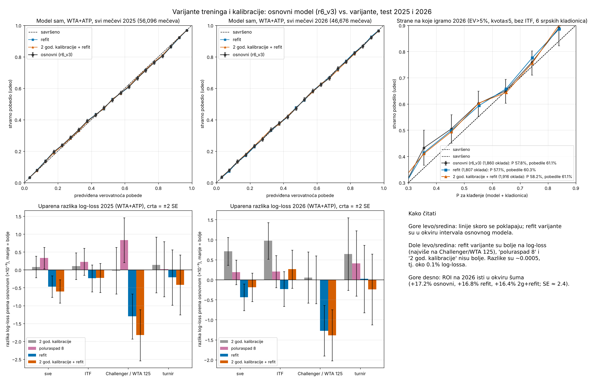

# Tennis betting ML (ATP + WTA, all levels)

Question: can a model built on the complete match history (futures/ITF, challengers, qualifying, main tour)
beat bookmaker prices? Short answer: **not at Bet365 margins.** The model carries a small amount of
information the price does not, but it is far smaller than the ~6% margin.

## Project requirements (from the owner)
- The model must **not** use bookmaker odds as features. Odds are used only to decide value and settle bets.
- The model must have **at least 150 features**.
- Iterate on a short recent window first (last ~5 years); extend the history only when asked.
- Development period 2021-2024 is used for iterating on features; 2025-2026 is a locked holdout evaluated once.

## Data
- **Matches:** Jeff Sackmann's `tennis_atp` / `tennis_wta` (the GitHub originals are no longer reachable;
  used the archival mirror `Aneeshers/tennis-sackmann-archive` on Hugging Face, CC BY-NC-SA 4.0).
  1991 - June 2026: 855k ATP and 675k WTA matches across all levels.
- **Odds:** tennis-data.co.uk Bet365 match odds via the Kaggle "ATP/WTA tennis daily" dataset mirrored on
  Hugging Face (`groundhog2107/atp_tennis`, `Nevoreuven/tennis-betting-odds-model`). tennis-data.co.uk itself
  is behind a Cloudflare block from this environment. Bookmaker identified from the margin (5.3-7%).
  Odds are matched to Sackmann matches by name + date window: 97.7% (ATP) / 94.6% (WTA) of rows, the
  winner agrees on 99.9%.

## Method
- `build.py` - one chronological pass over every match: overall and surface Elo (538-style K), form (last 10,
  52 weeks, surface), rest days, matches in the last 14 days, minutes in the last 7 days, serve/return points
  won over the last 30 matches with stats, head-to-head. All features are strictly pre-match.
- `train_bet.py` - walk-forward XGBoost: train on all levels for the previous 12 years, predict the next
  year's tour-level matches that have odds. Retirements void the bet unless the first set was completed.
  Margin is removed proportionally for the "fair" market probability; bets are settled at the real odds.
  A stacking logistic model (market logit + model logit, fit on prior years only) tests whether the model
  adds information beyond the price.
- `segments.py` - ROI by segment and sensitivity to the bookmaker margin.

## Results
| | ATP 2006-2026 | WTA 2009-2025 |
|---|---|---|
| Matches with odds | 47,873 | 36,191 |
| Bet365 median margin | 6.4% | 6.2% |
| Log-loss market / XGBoost / Elo | **0.568** / 0.577 / 0.586 | **0.581** / 0.589 / 0.597 |
| Accuracy market / XGBoost | **70.0%** / 69.1% | **68.9%** / 68.0% |
| XGBoost value bets EV>5% | 20,525 bets, **ROI -8.7%**, 1/21 years positive | 15,240 bets, **ROI -7.1%**, 1/17 |
| Bet every favourite | -4.8% | -5.1% |
| Stacked market+model EV>5% | 277 bets, +3.1% (CI -10%..+17%) | 252 bets, +13.5% (CI -3.5%..+33%) |

- The stacking coefficient on the model is a stable ~0.2 every year: the model knows *something* the price
  doesn't, but bets on its disagreements with the market lose more than the margin.
- No segment (low-experience players, outside top-100, early rounds, Slams) shows a significant edge.
- Margin sensitivity (odds rebuilt from Bet365's fair price): the stacked strategy is ~+1.5-2% ROI at
  2-3% margin (Pinnacle-like or best price across books), roughly at the edge of significance. This is an
  optimistic estimate: Pinnacle's own prices are sharper than Bet365's fair price.

## Next step if pursuing this
Get Pinnacle and max-odds columns (tennis-data.co.uk xlsx files contain `PSW/PSL`, `MaxW/MaxL`; download them
from a normal browser) and re-run the test against Pinnacle closing odds. Beating Pinnacle closing is the
real bar; soft books like Bet365 also limit winning accounts quickly.

## Pre-registered out-of-sample test (written before looking at 2020+ Pinnacle/Max odds)
Finding on 2014-2019 (dev): the model (r6_hist1991_ens, no odds as features) is profitable when settled at
best-available (Max) odds: ATP value>5% & odds<=3 -> +4.1% ROI on 6,211 bets (5/6 years positive), clearly above
random bets at the same prices (+0.85%). At Bet365 it loses; at Pinnacle it is about +1%.

Rules fixed now, evaluated once on ATP 2020-2024 (dev predictions, odds never inspected) and on the locked
2025-2026 holdout (model trained 2010-2023, early stopping 2024):
- **Rule A (primary):** ATP, bet a player when p_model * MaxOdds > 1.05 and MaxOdds <= 3.0, flat 1 unit.
- **Rule B:** same model, Pinnacle odds, p_model * PSOdds > 1.02 and PSOdds <= 3.0.
Success = ROI > 0 with a 90% bootstrap interval above zero, separately on 2020-2024 and on 2025-2026.

## Results of the pre-registered test and the Challenger/ITF test
- **Rule A (Max odds)**: 2020-2024 **PASS** (+3.8% ROI, 90% CI [+1.3%, +6.4%], 4,474 bets); 2025-2026 holdout **FAIL**
  (-7.8%). The tennis-data "Max" column has a 1.2-2.7% margin from 2025 (about 0% before), so that edge depended on a
  best-price source that changed. **Rule B (Pinnacle)**: FAIL on both.
- **Challenger/ITF** (Kaggle "A large Tennis dataset for ATP and ITF betting", odds 2009-2018, mostly OddsPortal):
  the same model (no odds as features) on ATP 2014-2018:
  - ITF/Futures (14,055 matches, 8.2% margin): the model's log-loss **beats the market** (0.5435 vs 0.5455).
    Value >5% & odds <= 2: **+5.9% ROI**, 90% CI [+3.6%, +8.0%], 2,602 bets, 5/5 years positive. All 9 rule variants
    are positive. Betting every favourite at the same prices: -4.6%; 2,000 random draws of the same size: mean -5.1%,
    99th percentile -2.4%. The model beats all of them.
  - Challenger: about break-even. Qualifying: negative.
- Caveats: the ITF segment was identified on 2014-2018 and no later ITF odds are available yet, so a forward
  (paper-trading) test is the remaining proof. ITF markets have low limits and integrity risk (match-fixing).

## Pre-registered: fresh 2012-2013 test (written before running those years)
- **ITF rule** (found on 2014-2018): ATP ITF/Futures, bet when p_model * odds > 1.05 and odds <= 2.0, flat stake.
  Success = ROI > 0 on 2012-2013 combined.
- **Challenger**: any segment rule must be chosen on 2012-2015 and confirmed on 2016-2018.

### Result of the 2012-2013 test
- **ITF rule: PASS.** 2012-2013 (never seen before): **+7.7% ROI** on 2,091 bets (2012 +10.4%, 2013 +4.0%).
  ITF 2012-2018 overall: +6.7% ROI on 4,693 bets (90% interval about +/-1.7%). All lower levels together in 2012-2013:
  model log-loss 0.5583 vs market 0.5634.
- **Challenger: no reliable edge.** Overall ~0% (explore 2012-2015 +1.3%, confirm 2016-2018 -1.3% at odds <= 2).
  No segment (experience, ranking, round, surface) is positive in both halves with a meaningful margin; the best
  ("weaker player ranked >300", any odds) is +1.9% / +3.1% but within noise.

## Pre-registered: new ITF odds sources (written before running)
Sources: Kaggle "Tennis Results and Betting Odds (2014-2025)" (TennisExplorer; Bet365/Betfair/Ladbrokes/Unibet/best;
women's ITF + men's Challenger, almost no men's ITF) and "Tennis Closing Odds: Pinnacle vs 1xBet" (Mar-Sep 2026,
men's and women's ITF + Challenger).
- **Women's ITF 2014-2025** (new domain): same ITF rule, p_model * odds > 1.05 and odds <= 2.0, at Bet365 and at
  best odds. Success = ROI > 0 with 90% interval above zero.
- **Men's Challenger 2019-2025** (years not tested before): same rule; expectation from 2012-2018 is ~0%.
- **2026 ITF (men + women) at Pinnacle and 1xBet**: same rule, holdout models (trained up to 2024).

### Result: women's ITF 2014-2025 (walk-forward, 131k matches)
| Odds | Margin | Bets | ROI | 90% CI | Years + | Random bets, same odds |
|---|---|---|---|---|---|---|
| Bet365 | 7.4% | 21,127 | -0.3% | [-1.1, +0.5] | 3/12 | -4.7% |
| Best price | 4.8% | 26,558 | **+1.7%** | [+1.0, +2.4] | 11/12 | -2.0% |

Bet365: FAIL. Best price: PASS. The model beats random selection by 4-5 points at every source, but a 7% margin
absorbs the edge. Best price is an upper bound (needs many accounts; the maximum is often stale or stake-limited).
WTA125 and WTA Tour: no significant edge at any source.

### Men's ITF 2024-2026 at BetExplorer average odds (pre-registered same rule, written before running)
Scraped 1,044 BetExplorer men's ITF result pages (2024-2026); 17,813 Sackmann matches matched (41%), median margin
9.0% (average odds across bookmakers, so harsher than any single sharp book). Rule: EV>5%, odds<=2.

### Result: men's Challenger 2014-2025 (TE odds)
Bet365 EV>5% odds<=2: -3.0% (6,152 bets, 2/12 years +). Best price: +1.2%, CI [-0.1, +2.3] -> FAIL, as expected.

### Odds-range systems (user request: bet only at odds >= 2, 2.5, ... 5) - `odds_systems.py`
Post-hoc exploration, reported with an explore half / confirm half of the years.
- Odds floors (only odds >= X) are worse than no floor at Bet365 for women's ITF (EV>5%: -2.5% all odds,
  -4.0% at >=2, -5.6% at >=3, -8.9% at >=5): the favourite-longshot bias works against high odds.
- "Model flips the favourite" (market underdog the model rates >60%) showed +36% ROI, 12/12 years on women's ITF.
  **This is a data artefact, not an edge.** The TennisExplorer odds have swapped prices on some ITF matches
  (e.g. a #400 player at 11.00 vs a #848 player at 1.02, won 6-1 6-0; best price disagrees with Bet365 on the
  favourite in 11% of these bets). Even without a rank-inversion signature, dog odds >= 3.5 showed +201% ROI,
  impossible on real prices. The model spots the mispriced row and the backtest pays out a price no bookmaker
  offered. The ehallmar men's ITF data shows the same pattern at smaller scale.
- Consequence: **backtests on these free datasets are not trustworthy at odds above ~2.5.** The odds<=2 cap in the
  pre-registered rule protects against this (a swapped row puts the true favourite at the long price, which the
  cap excludes), which is why it stays the only rule used for decisions.

### Tactic screen (`tactics.py`): ~50 tactics per segment, explore/confirm halves, no-skill control
Survivor = >=300 bets, positive in both halves, 90% lower bound > 0. Control: model probabilities shuffled within
year (5 shuffles) -> 0-2 survivors per segment, so the screen itself rarely produces false positives. It does not
control for bad odds data, though: every "model p>X & EV>0" survivor on women's ITF and Challenger comes from a
handful of bets at odds > 2 with +130% to +1000% ROI (swapped-price rows). Capped at odds <= 2 they shrink to ~+1%.
- ATP Tour (Bet365 and best): 0 survivors.
- Challenger: Bet365 nothing clean; best price only small (+2 to +3%).
- Women's ITF: Bet365 nothing clean at odds <= 2 above ~+2%; best price +1 to +4%.
- Men's ITF 2012-2018: 41 of 48 survive, all subsets of the core rule (EV>5%, odds<=2, +6.7%). Strongest:
  lefty bettee +13.8% (627 bets), EV>20% +13.7% (851), opponent 3+ matches in 7 days +11.6% (712), opponent with
  retirements in the last year +10.5% (1,510), odds 1.6-2.0 +10.2% (1,510), rising Elo +8.7% (3,009).

## Pre-registered: men's ITF 2024-2026 at BetExplorer average odds (written before the predictions finished)
Primary: core rule EV>5% & odds<=2 (success = ROI > 0 with 90% lower bound > 0).
Secondary (picked from the 2012-2018 screen, reported regardless of outcome): EV>10% odds<=2; EV>20% odds<=2;
EV>5% odds 1.6-2.0; core & opponent retires often; core & opponent played yesterday; core & rising Elo;
core & opponent 3+ matches in 7 days; core & lefty. Average odds carry ~9% margin, so a best-price bettor would do
better than this test shows.

### Result: men's ITF 2024-2026 at BetExplorer average odds -> FAIL
17,812 matches, margin 9.0%. Log-loss market 0.5330 vs model 0.5424: the market now beats the model (in 2012-2018
the model beat it, 0.5435 vs 0.5455). The market got sharper; the model did not get worse.
| Rule | Bets | ROI | 90% CI | Random at odds<=2 |
|---|---|---|---|---|
| PRIMARY EV>5% odds<=2 | 2,439 | -2.9% | [-5.4, -0.5] | -3.9% |
| EV>10% odds<=2 | 1,225 | -4.4% | [-8.0, -0.7] | -4.1% |
| EV>20% odds<=2 | 339 | -8.6% | [-16.3, -1.2] | -4.0% |
| core & opp retires often | 489 | +1.1% | [-4.5, +7.0] | -3.8% |
| core & opp played yesterday | 1,039 | -1.3% | [-5.0, +2.4] | -4.0% |
| core & lefty | 240 | -3.9% | [-11.8, +3.7] | -4.5% |
By year (primary): 2024 +4.8%, 2025 -3.6%, 2026 -7.1%. The 2012-2018 men's ITF edge does not hold on current
prices; none of the subset tactics picked from the 2012-2018 screen holds either.

## Opening odds (moneyline) - `eval_open.py`
Same walk-forward predictions, settled at Bet365 OPENING prices from the TennisExplorer data instead of closing.
EV>5% & odds<=2, 2020-2025 ("modern market"):
| Segment | Bet365 close | Bet365 OPEN | best OPEN |
|---|---|---|---|
| ATP Tour | -5.2% | -0.8% | +1.5% |
| Challenger | -2.8% | +2.8% (4,253 bets, 90% lo +0.8%) | +4.7% |
| Women's ITF | -1.1% | **+4.9%** (11,825 bets, 90% lo +3.8%) | +7.0% |
| WTA125 | -2.5% | +5.4% (868) | +7.7% |
| WTA Tour | -2.3% | +4.8% (1,593) | +7.1% |
The picks get closing-line value: Bet365 shortens the model's side by +4.8% on average between open and close
(women's ITF; +5.4% Challenger; random sides +0.2%). The model anticipates the market's own moves, which does not
depend on match outcomes. Women's ITF at Bet365 open is positive in 11 of 12 years (2014-2025).
Caveats: all 2014-2025 years have now been looked at; opening prices carry low stake limits and accounts that take
them get limited; TE opening odds may include a few erroneous prices (moves >= 25% are 2% of bets).

## Pre-registered: 2026 opening-odds test on fresh data (written before scraping)
Data: BetExplorer odds history for 2026 matches (Jan-Jun, Sackmann coverage). From this server only BetMGM.us is
listed, so the test is at BetMGM.us opening prices (first price in its history), not Bet365.
Model: walk-forward ens trained to 2024, calibrated on 2025 (no 2026 data).
Primary: women's ITF 2026, EV>5% & odds<=2 at the opening price. Success = ROI > 0 and 90% lower bound > 0.
Also reported: the same at BetMGM closing price, and mean closing-line value of the picks (open/close - 1);
CLV > random sides is the secondary success signal, since a few hundred bets give a wide ROI interval.

## Total games (over/under) - `train_totals.py`, `eval_totals.py`
Regression on total games from the same 481 features (no odds), walk-forward; P(over L) from the predicted mean +
the validation-year residuals. Settled at Bet365 / Unibet / Ladbrokes lines from TennisExplorer; retired = void.
Men (75,996 matches with a line): RMSE ~6.0-6.2 games vs sd 7.0-7.4. Over log-loss model 0.6906 vs market 0.6927
(slightly better than Bet365's line), but Bet365 totals margin is 8.2%.
| Men, Bet365 | Rule | 2014-19 | 2020-25 |
|---|---|---|---|
| Challenger close | EV>5% both sides | +2.7% (5,107) | -1.6% (3,706) |
| Challenger close | EV>10% over | +6.3% (1,582) | +0.6% (532) |
| Challenger OPEN | EV>3% both | +2.3% (6,940) | +0.9% (6,178), 10/12 yrs+ |
| Challenger OPEN | EV>10% both | +5.9% (2,328) | +2.8% (1,181) |
| Tour close | EV>5% both | +7.4% (4,487) | -5.3% (3,015) |
| Tour OPEN | EV>10% both | +11.7% (2,579) | -1.0% (1,480) |
Men's totals at closing prices: FAIL on the modern market (explore half positive, confirm half negative).
At opening prices Challenger stays slightly positive in 2020-25 but within noise (+2.8% on 1,181 bets, se ~2.8%).
"Best book" totals rows (+30-80%) are a data artefact: in 2014-19 even random overs return +6-12% there, i.e. the
Unibet/Ladbrokes over prices in the free data are often for a different line; ignore them.
Women (27,411 matches with a Bet365 line, no ITF lines in the data): RMSE 5.65-5.76 vs sd 5.7-5.85, i.e. the model
explains almost nothing of the total (log-loss 0.6897 vs market 0.6956 only because the line is at ~50/50).
WTA Tour 2020-25: every rule negative (EV>5% both -5.4% close / -4.0% open; overs -11% to -14%).
WTA125 open EV>10% +4.1% on 367 bets: noise. Women's totals: FAIL.

### Result: women's ITF 2026 at BetMGM.us opening prices -> primary FAIL, secondary PASS
`parse_betexplorer_open.py` + `eval_open2026.py`. 4,199 women's ITF matches Jan-May 2026 (end of Sackmann
coverage) with BetMGM open and close; BetMGM margin 9.1% (Bet365 in the TE data: ~6%). The archive gives one entry
per price: the opening odds (opens ~0-1 day before the match); 64% of matches moved between open and close.
Log-loss: model 0.5504, BetMGM fair close 0.5393.
| Rule | Bets | ROI @open (90% lo) | ROI @close | CLV of picks |
|---|---|---|---|---|
| random sides odds<=2 | 4,732 | -4.5% (-6.1%) | -4.7% | +0.2% |
| **PRIMARY EV>5% & open<=2** | 722 | **+0.6% (-3.9%)** | -5.3% | **+6.45%** |
| EV>0% & open<=2 | 1,321 | -2.3% | -6.3% | +4.6% |
| EV>10% & open<=2 | 384 | +1.5% | -6.4% | +8.4% |
| EV>5% & open<=2.5 | 939 | -0.9% | -6.6% | +6.4% |
Primary by month: Jan +1.6%, Feb -0.9%, Mar -4.0%, Apr +2.4%, May +11.2%.
Reading: the pre-registered ROI criterion fails (lower bound below 0). The secondary signal passes clearly: on
unseen 2026 data the bookmaker moves the model's pick by +6.45% on average between open and close (random sides
+0.2%), and the stronger the model's EV the larger the move. The model's edge over the opening line is real; at a
9% margin it is almost exactly eaten. Exploratory (not pre-registered) - the same picks re-priced at a lower
margin (BetMGM fair opening price with the overround reset): 6% -> +3.3% (958 bets), 4% -> +2.6%, 2% -> +4.3%,
0% -> +6.7% (random sides at 0%: +3.5%, a favourite-longshot bias at odds<=2). So the plan only works with
low-margin opening prices (Bet365/Pinnacle/exchange), not with a 9% book.

## Pre-registered: Challenger and men's ITF 2026 opening-odds test (written before the data was parsed)
Same rule and setup as the women's ITF 2026 test: BetMGM.us opening price, EV>5% & odds<=2, model trained to 2024
and calibrated on 2025. Challenger predictions: preds3_atp_ens_r6_hist1991_ens_lower_2026.parquet, level 'C'.
Men's ITF: same file, levels '^\d|S'. Success = ROI > 0 with 90% lower bound > 0; secondary = CLV of picks above
random sides.

### Opening odds by bookmaker (TE data, EV>5% & odds<=2, 2020-2025) - `eval_open.py`
Added Betfair (5% commission), Unibet and Ladbrokes opening prices (`attach_te_extra.py`).
| Segment | b365 OPEN | Unibet OPEN | Ladbrokes OPEN | Betfair close | Betfair OPEN |
|---|---|---|---|---|---|
| Women's ITF | +4.9% (11,825) | -1.9% (5,785) | +1.8% (8,651) | -4.3% (3,942) | unusable |
| Challenger | +2.8% (4,253) | -1.1% (2,884) | +1.8% (3,493) | -3.6% (3,710) | unusable |
| WTA Tour | +4.8% (1,593) | +2.2% (1,175) | -0.1% (1,108) | -3.1% (1,373) | unusable |
Betfair "opening" prices have 26-92% overround (thin first exchange books), so they cannot be used; at Betfair's
closing prices every segment loses. The opening-price edge is not general: it is strongest at Bet365 (and BetMGM by
CLV, 2026), weaker at Ladbrokes, absent at Unibet. It is an edge against specific bookmakers' soft opening lines,
not against the market, and those are exactly the books that limit winning accounts.

### Result: Challenger 2026 at BetMGM.us opening prices -> PASS (pre-registered)
2,440 Challenger matches Jan-May 2026 with BetMGM open and close (margin open 8.7%, close 8.1%).
Log-loss: model 0.5960, BetMGM fair close 0.5936.
| Rule | Bets | ROI @open (90% lo) | ROI @close | CLV of picks |
|---|---|---|---|---|
| random sides odds<=2 | 2,838 | -3.6% (-5.8%) | -3.3% | -0.6% |
| **PRIMARY EV>5% & open<=2** | 348 | **+8.5% (+2.0%)** | -1.9% | **+10.4%** |
| EV>0% & open<=2 | 710 | +6.5% (+2.1%) | -1.1% | +7.6% |
| EV>2% & open<=2 | 539 | +7.0% (+1.9%) | -1.5% | +8.7% |
| EV>10% & open<=2 | 156 | +5.7% (-4.6%) | -7.5% | +13.6% |
| EV>5% & open<=2.5 | 543 | +10.0% (+3.8%) | -1.6% | +11.8% |
Primary by month: Jan +7.4%, Feb +8.5%, Mar +7.0%, Apr +8.0%, May +25.5% (15 bets) - positive every month.
Robustness (`robust_open2026.py`): picks win 69.3% vs model 69.7% vs opening-implied 63.0% (calibrated);
bootstrap 90% interval [+1.8%, +14.9%]; shuffle null (model probabilities permuted, 300 runs) mean -6.5%, never
reaches +8.5%; 87 different tournaments; 14 void. The profit sits in picks whose price then moved a lot
(median CLV +10%; picks with |CLV|<=15% only +0.5%, picks with no move -12.8% on 38 bets), i.e. the model finds
BetMGM opening prices that are stale relative to where the market goes.
At the same price the bet at BetMGM CLOSE loses (-1.9%): timing is the whole edge.

Pooled pre-registered 2026 primary (women's ITF + Challenger): 1,070 bets, about +3.2%.

### Result: men's ITF 2026 at BetMGM.us opening prices -> primary FAIL, secondary PASS
3,742 matches Jan-May 2026, BetMGM margin 9.05%. Log-loss model 0.5544 vs fair close 0.5379.
| Rule | Bets | ROI @open (90% lo) | ROI @close | CLV of picks |
|---|---|---|---|---|
| random sides odds<=2 | 4,158 | -5.3% (-6.9%) | -5.3% | -0.15% |
| **PRIMARY EV>5% & open<=2** | 479 | **+0.1% (-5.5%)** | -5.0% | **+5.55%** |
| EV>10% & open<=2 | 262 | -2.3% | -8.5% | +6.9% |
Q1 +0.3% (348), Q2 -0.3% (131). Picks win 65.3%, opening-implied 65.0%, model said 73.3%: the men's ITF model is
overconfident on its picks. Again the picks' prices shorten (+5.6% vs random -0.15%; shuffle null never matches),
but at a 9% book that only reaches break-even.

### 2026 pre-registered summary (BetMGM.us opening prices, EV>5% & odds<=2)
| Segment | Bets | ROI | CLV | Verdict |
|---|---|---|---|---|
| Challenger | 348 | +8.5% (90% lo +2.0%) | +10.4% | PASS |
| Women's ITF | 722 | +0.6% | +6.5% | fail (CLV pass) |
| Men's ITF | 479 | +0.1% | +5.6% | fail (CLV pass) |
| All three | 1,549 | ~+2.3% | | |
The scraper's adaptive rate reached 148 requests/s on BetExplorer without a single error.
Next: the same test on the full 2025 season (predictions trained to 2023, calibrated on 2024).

## 2025 + 2026 at BetMGM.us opening prices (same rule, EV>5% & odds<=2)
2025 predictions: walk-forward ens trained to 2023, calibrated on 2024, for every 2025 match (`train3.py --years=2025`
with dummy odds). Odds: BetExplorer 2025 season pages plus 2025 matches on the current-season pages (both sources
are needed; the `-2025` pages miss most late-2025 events). Note: 2025 outcomes were part of the 2014-2025 TE study
that suggested opening odds (at Bet365 prices); BetMGM prices and this rule were not tuned on them.
| Segment | 2025 bets | 2025 ROI (90% lo) | 2025+2026 bets | 2025+2026 ROI (90% lo) | CLV picks / random |
|---|---|---|---|---|---|
| Women's ITF | 2,682 | **+4.7% (+2.5%)** | 3,404 | **+3.8% (+1.9%)** | +6.3% / +0.3% |
| Challenger | 986 | +1.6% (-2.4%) | 1,334 | +3.4% (+0.0%) | +8.8% / -0.2% |
| Men's ITF | 1,258 | +3.3% (+0.1%) | 1,740 | +2.4% (-0.4%) | +5.6% / +0.0% |
Women's ITF by quarter: 2025 Q1 -0.7% (182), Q2 +6.7% (916), Q3 +4.4% (980), Q4 +3.5% (604), 2026 Q1 -1.6% (466),
Q2 +4.6% (256). Challenger: 2025 Q1 +2.3%, Q2 -2.0%, Q3 +2.6%, Q4 +4.1%, 2026 Q1 +7.7%, Q2 +10.3%.
At BetMGM CLOSING prices the same picks lose in every segment (-2.0% women's ITF, -4.7% Challenger): the edge is
only in taking the opening price. The 9% BetMGM margin is the worst case; a lower-margin opening book should do better.

### Pooled 2025+2026, all three segments (`pool_open.py`)
6,478 bets, ROI **+3.35%**, 90% lower bound **+1.9%**, mean odds 1.54, ~380 bets/month, 14 of 17 months positive.
Flat 1-unit stakes: +217 units, max drawdown 64 units. This is at BetMGM.us, a 9% margin book; the picks' prices
shorten by 5.6-8.8% before the match while random sides do not move.

### EV threshold ladder toward ~1 bet a day (`ev_ladder.py`, exploratory - thresholds chosen after seeing 2025-26)
Pooled women's ITF + Challenger + men's ITF, BetMGM.us opening prices, 2025-01-06..2026-05-13 (493 days), odds<=2:
| EV > | Bets | Per day | ROI | 90% lo | Units (flat 1u) | Max DD | 2025 | 2026 |
|---|---|---|---|---|---|---|---|---|
| 5% | 6,478 | 13.1 | +3.4% | +1.9% | +217 | 21 | +3.7% | +2.2% |
| 10% | 3,495 | 7.1 | +4.1% | +2.0% | +142 | 24 | +5.0% | +1.1% |
| 12% | 2,652 | 5.4 | +4.9% | +2.5% | +130 | 14 | +5.4% | +3.0% |
| 16% | 1,618 | 3.3 | +6.2% | +3.0% | +100 | 14 | +6.7% | +4.2% |
| 20% | 941 | 1.9 | +5.8% | +1.5% | +55 | 16 | +6.3% | +4.1% |
| **25%** | **528** | **1.07** | **+7.2%** | **+1.2%** | **+38** | **17** | +6.5% | +10.1% |
| 30% | 292 | 0.6 | +8.5% | +0.4% | +25 | 10 | +6.7% | +17.8% |
ROI rises with the threshold up to ~16% and then levels off at +6-8%; ~1 bet a day is EV>25% (+7.2%, still positive
at the 90% lower bound). Fewer bets mean less total profit at flat stakes (+38u vs +142u at EV>10%) and a wider
interval. With odds<=3 instead of <=2 every row is worse (EV>25%: +2.5%, lower bound -2.2%): keep the odds<=2 cap.

### Odds above 2: why the raw rule fails there, and a recalibration (`blend_open.py`, exploratory)
Calibration by opening-odds band, all 2025-26 sides (women's ITF + Challenger + men's ITF, BetMGM.us):
| Odds | Sides | Model | Market fair | Actual | ROI (all sides) |
|---|---|---|---|---|---|
| 1.0-1.5 | 21,064 | 0.766 | 0.739 | 0.784 | -2.6% |
| 1.5-2.0 | 15,277 | 0.538 | 0.533 | 0.541 | -7.0% |
| 2.0-2.5 | 8,584 | 0.403 | 0.414 | 0.392 | -13.2% |
| 2.5-3.0 | 5,559 | 0.318 | 0.338 | 0.299 | -18.8% |
| 3-4 | 6,070 | 0.238 | 0.266 | 0.237 | -18.2% |
| 4-6 | 4,595 | 0.158 | 0.190 | 0.132 | -36.9% |
| 6+ | 2,845 | 0.089 | 0.125 | 0.051 | -63.4% |
1. BetMGM has a strong favourite-longshot bias: above odds 4 the outsider wins far less than even the fair price says.
2. Among the model's own picks (EV>5%) the model is overconfident: at 2.0-2.5 it says 0.539, market 0.415, actual
0.446 - it captures only about a quarter of its claimed gap, so EV above 2 is inflated (picks 2-3: ~0% ROI).
Recalibration: P = logistic(a*logit(model) + b*logit(fair open) + c), fitted on 2025 and applied to 2026 and vice
versa (weights ~0.4-0.5 model, ~0.7-0.9 market). Pooled out-of-sample, 2025+2026:
| Rule | Bets | ROI | 90% lo | 2025 / 2026 |
|---|---|---|---|---|
| raw EV>5% odds<=2 (reference) | 6,478 | +3.4% | +1.9% | +3.7% / +2.2% |
| blend EV>5% odds<=2 | 1,720 | +4.6% | +1.8% | +5.7% / +1.7% |
| blend EV>10% odds<=2 | 357 | +8.7% | +2.2% | +10.1% / +5.5% |
| blend EV>5% odds<=3 | 2,087 | +4.4% | +1.7% | +5.4% / +2.5% |
| blend EV>5% odds<=4 | 2,196 | +7.6% | +4.6% | +7.7% / +7.3% |
| blend EV>10% any odds | 695 | +15.4% | +7.8% | +18.0% / +11.4% |
With the blend, odds 2-3 are no longer losing. The big jump from odds 3-4 upward is NOT a reliable edge: model picks
at 3-4 earn +54% when BetMGM later cut the price by more than 30% (193 bets) and only +0.6% otherwise (940 bets).
Those are opening prices the book itself corrected sharply (stale or erroneous lines); such bets are the ones books
void as "palpable errors" or accept only with tiny limits. Treat everything above odds 3 as unproven.

### Realistic check: void the bets the book later cut by >30% (worst case for stale/erroneous opening lines)
| Rule | Bets | Per day | ROI as-is | ROI if >30% movers are void (90% lo) | Share >30% movers |
|---|---|---|---|---|---|
| raw EV>5% odds<=2 | 6,478 | 13.1 | +3.4% | **+2.8% (+1.4%)** | 1.9% |
| raw EV>10% odds<=2 | 3,495 | 7.1 | +4.1% | **+3.2% (+1.1%)** | 3.3% |
| raw EV>16% odds<=2 | 1,618 | 3.3 | +6.2% | **+4.2% (+1.1%)** | 6.2% |
| raw EV>25% odds<=2 | 528 | 1.1 | +7.2% | +4.5% (-1.1%) | 10.6% |
| raw EV>5% odds<=3 | 9,507 | 19.3 | +2.1% | +0.8% (-0.6%) | 4.2% |
| blend EV>5% odds<=3 | 2,087 | 4.2 | +4.4% | +2.6% (+0.0%) | 6.9% |
| blend EV>10% odds<=3 | 548 | 1.1 | +7.1% | +1.9% (-3.7%) | 14.4% |
| blend EV>5% odds 2-3 only | 367 | 0.7 | +4.0% | -1.0% (-9.4%) | 20.2% |
Realistically, odds 2-3 do not add profit: what they earn comes from opening prices the book corrected sharply,
and without those they lose. The higher the EV threshold, the more of the profit comes from such big movers.
The most robust rule is the original one: raw model, odds<=2, EV between 5% and ~16%
(+2.8% to +4.2% even if every big mover is voided, lower bound > 0).

## Bet365 opening prices only (`b365_open.py`, TE data 2020-2025)
Walk-forward predictions (each year trained to Y-2, calibrated on Y-1). Bet365 opening odds from TennisExplorer;
void stress = bets whose Bet365 price was cut by >30% before the close are refunded. Bet365 margin ~6-7.5%.
| Segment, EV>5% odds<=2 | Bets | ROI (90% lo) | Void stress (lo) | By year 2020..2025 |
|---|---|---|---|---|
| Women's ITF | 11,824 | +4.9% (+3.8%) | +4.3% (+3.2%) | +3 +6 +6 -0 +7 +5 |
| WTA125 | 868 | +5.4% (+1.2%) | +5.2% (+1.0%) | |
| WTA Tour | 1,593 | +4.8% (+1.6%) | +4.4% (+1.2%) | +2 +4 +3 +13 +6 -1 |
| Challenger | 4,253 | +2.8% (+0.8%) | +2.2% (+0.2%) | +3 +2 +4 +4 +5 -0 |
| ATP Tour | 1,777 | -0.8% | -1.1% | no edge |
Pooled women's ITF + WTA125 + WTA Tour + Challenger:
| Rule | Bets | Per day | ROI (90% lo) | Void stress (lo) | Years positive |
|---|---|---|---|---|---|
| EV>5% odds<=2 | 18,538 | 8.6 | +4.4% (+3.5%) | +3.8% (+3.0%) | 6/6 |
| EV>10% odds<=2 | 9,597 | 4.4 | +6.3% (+5.0%) | +5.2% (+3.9%) | 6/6 |
| **EV>16% odds<=2** | **4,440** | **2.1** | **+8.6% (+6.6%)** | **+6.5% (+4.6%)** | **6/6** |
| EV>25% odds<=2 | 1,434 | 0.7 | +8.4% (+4.8%) | +3.8% (+0.4%) | 5/6 |
| EV>10% odds<=3 | 17,676 | 8.2 | +5.4% (+4.1%) | +3.2% (+2.0%) | 6/6 |
| EV>16% odds<=3 | 9,855 | 4.6 | +7.2% (+5.5%) | +3.5% (+1.9%) | 6/6 |
By odds band (EV>5%): 1-1.5 +5.1% (void stress +5.1%, almost no big movers), 1.5-2 +4.0% (+2.9%),
2-2.5 +2.6% (+0.3%), 2.5-3 +4.5% (+0.5%), 3-4 +7.2% (+2.2%), 4+ +0.4% (-5.1%).
At Bet365 the edge is about twice the BetMGM one and holds in every year; it is still concentrated at odds<=2, and
above 2 it again leans on big line moves. Caveats: this is the data in which the opening-odds effect was found
(not a fresh test - the fresh confirmation is the BetMGM 2025-26 test above), TE's opening snapshot time is
unknown, and Bet365 restricts the stakes of accounts that consistently beat its opening lines.
Stake: no historical Stake odds are available here (BetExplorer from this server lists only BetMGM.us, and
stake.com is not reachable from a US server); testing Stake needs its opening odds collected going forward.

## Calibration methods for the bet decision (`calib_open.py`, Bet365 opening, walk-forward)
Online research: calibration matters more than accuracy for betting (Walsh & Joshi 2024, Machine Learning with
Applications 16:100539); beta calibration (Kull et al. 2017) as an alternative to Platt; Shin's method for removing
the bookmaker margin puts more of it on the longshot, which matches the favourite-longshot bias.
Methods, each map fitted only on years before the test year (2014..Y-1), scored on 2020-2025 (women's ITF + WTA125 +
WTA Tour + Challenger, 101,496 matches). Log-loss on all sides:
| Market fair (proportional) | Market fair (Shin) | Model raw | Beta-calibrated model | Blend model+market | Blend model+Shin | Blend+Shin, own slopes above 2 |
|---|---|---|---|---|---|---|
| 0.5757 | 0.5738 | 0.5757 | 0.5757 | 0.5696 | **0.5695** | 0.5694 |
The model and the market are equally good alone, and the blend beats both: the model adds information the opening
line does not have. Beta calibration of the model alone changes nothing.
Bets, EV>5%, ROI as-is / if bets whose price was cut >30% are void / if bets whose fair win probability rose >12
points are void:
| Odds | Raw model | Shin blend |
|---|---|---|
| 1-2 | 18,538: +4.4% / +3.8% / +3.0% | **4,785: +8.1% / +6.5% / +4.4%** (all lower bounds > +2.9%) |
| 2-3 | 10,989: +3.3% / +0.4% / +1.1% | 2,134: +7.6% / -0.1% / -0.1% |
| 3-5 | 7,460: +6.3% / +1.1% / +3.6% | 1,180: +17.5% / +4.7% / +8.2% (lo of last +0.8%) |
| 5+ | 3,145: -1.7% / -7.3% / -4.1% | 332: +24.4% / +7.4% / +12.8% (lo -9.9%) |
| <=3 total | 29,527: +4.0% / +2.6% / +2.3% | 6,919: +7.9% / +4.5% / +3.0% |
Conclusions: the Shin blend nearly doubles the edge at odds <=2 (+8.1%, ~2.2 bets/day over these four segments) and
it survives both stress tests. Odds 2-3 stay at ~0% under both stress tests whatever the calibration: the profit
there is line-movement, not calibration. Odds 3-5 with the Shin blend are a possible second market (+8% under the
probability stress, lower bound just above 0) but not proven. Above 5: no.

### Out-of-sample: Shin blend fitted on Bet365 2014-2024, applied unchanged to BetMGM 2025-26 (`blend_transfer.py`)
Blend weights from TE Bet365 opening prices 2014-2024 only (377k sides): 0.44 * logit(model) + 0.64 * logit(Shin fair).
Applied to the fresh BetMGM.us 2025-26 opening prices (women's ITF + Challenger + men's ITF), nothing refitted:
| Rule | Bets | ROI (90% lo) | Void >12pt stress | 2025 | 2026 |
|---|---|---|---|---|---|
| raw EV>5% odds<=2 (reference) | 6,478 | +3.4% (+1.9%) | +1.9% | +3.7% | +2.2% |
| blend EV>5% odds<=2 | 1,695 | +5.7% (+2.9%) | +2.8% | +6.5% | +2.2% |
| blend EV>10% odds<=2 | 446 | +9.7% (+3.8%) | +4.5% | +8.8% | +13.9% |
| blend EV>5% odds<=3 | 2,278 | +5.2% (+2.3%) | +1.5% | +5.7% | +3.3% |
| **blend EV>5% odds<=5** | **2,526** | **+8.9% (+5.8%)** | **+4.4%** | **+8.9%** | **+8.9%** |
| blend EV>10% odds<=5 | 907 | +13.0% (+6.9%) | +5.5% | +11.4% | +18.4% |
The blend transfers across bookmakers and years: on data it never saw it beats the raw rule at every cap, every
segment is positive, and with it odds up to 5 become profitable even under the void stress (+4.4%).

## Boosting budget: early-stopping patience 2000 and a lower learning rate (`train3.py --patience/--trees/--lr-mult`)
Dev year 2024 only (2025-26 untouched), same matches, paired log-loss difference vs the round-6 setup
(learning rate 0.06/0.05, patience 60):
| WTA 2024 (16,718 matches) | Best iter XGB / LGBM | Log-loss | vs baseline (paired, z) | Women's ITF b365 open EV>5% |
|---|---|---|---|---|
| baseline, patience 60 | - | 0.55229 | - | 2,600 bets +7.0% |
| A: patience 2000, same rate | 428 / 307 | 0.55219 | -0.00009 (z -1.3) | 2,613 bets +6.7% |
| B: patience 2000, rate x0.33 | 1,126 / 1,361 | 0.55188 | -0.00041 (z -2.2) | 2,616 bets +7.7% |
A longer patience alone changes nothing (the best iteration is reached long before 2000 extra rounds). A three
times smaller learning rate gives a small but real improvement (-0.0004 log-loss, about 1% of the model's edge over
the market). Training takes ~6x longer. ATP running.

### Stake sizing on the fresh BetMGM 2025-26 picks (`kelly_sim.py`)
Blend (Bet365-fitted) picks in date order, Jan 2025 - May 2026; Kelly fraction uses the blend probability; drawdown
distribution over 200 reshuffled bet orders.
| Picks | Staking | Bank x after 17 months | Max DD (by date) | Max DD median / 95th pct (reshuffled) | P(bank < 50%) |
|---|---|---|---|---|---|
| EV>5% odds<=2 (1,695 bets, +5.7%) | flat 1% of start bank | 1.97 | 8% | 11% / 17% | 0% |
| | flat 2% | 2.94 | 13% | 17% / 28% | 0.5% |
| | Kelly x0.10, cap 2% | 4.5 | 16% | 20% / 28% | 0% |
| | Kelly x0.25, cap 3% | 11.7 | 27% | 36% / 50% | 0% |
| | Kelly x0.50, cap 5% | 46 | 45% | 56% / 74% | 2.5% |
| EV>5% odds<=5 (2,526 bets, +8.9%) | flat 1% | 3.25 | 12% | 12% / 21% | 0% |
| | Kelly x0.10, cap 2% | 16.8 | 20% | 22% / 31% | 0% |
| | Kelly x0.25, cap 3% | 104 | 33% | 39% / 53% | 0% |
Compounded multiples assume the book takes every stake at the opening price, which it will not (ITF opening
limits are small and winning accounts get limited); the drawdown columns are the useful part. Kelly x0.10-0.25
keeps the typical worst drawdown at 20-40%; half Kelly is too aggressive given model uncertainty.

## Literature notes (night research)
- Tennis market efficiency: Lyocsa & Vyrost (2018) find top-level tennis betting close to efficient once 40 rules
  are corrected for data snooping; Lobao & Rolla (2015) report behavioural biases; exchange studies of ATP-level
  matches cannot reject efficiency. No study found on ITF/Challenger opening lines - consistent with our result that
  the edge is in lower-tier opening prices, not in ATP Tour or closing prices.
- Opening vs closing: a Greek football study (Kalaitzakis et al. 2022) finds opening odds carry information the
  close does not fully capture; practitioners report early-bet edges that are gone by match day (our CLV result).
- Models: Kovalchik (2016) - Elo (FiveThirtyEight style) is the best results-only method, below the bookmaker
  consensus; career-to-date history helps most for LOWER-ranked players (59% -> 64%), which is where our edge is;
  margin-of-victory / weighted Elo variants improve on plain Elo (already in the 481 features).
- Calibration over accuracy for betting model selection (Walsh & Joshi 2024); Shin margin removal handles the
  favourite-longshot bias better than proportional (used in the blend).
Sources: muni.cz/en/research/publications/1397002, periodicos.fgv.br/rae/article/view/52958,
emerald.com/insight/content/doi/10.1108/EMJB-01-2021-0014, arxiv.org/pdf/1211.4000,
degruyterbrill.com/document/doi/10.1515/jqas-2015-0059, researchportal.bath.ac.uk (Walsh & Joshi 2024).

### How early the line opened (BetMGM 2025-26, blend EV>5% odds<=5, exploratory)
Opening timestamp vs the match day (start times unknown, so measured to the match day's midnight):
| Line opened | Picks | ROI (se) | CLV picks | Random sides ROI |
|---|---|---|---|---|
| >6h before the match day | 805 | **+15.4% (3.4%)** | +16.1% | -9.2% |
| 0-6h before the match day (evening before) | 783 | +6.0% (3.5%) | +10.7% | -9.8% |
| match day, first 6h | 578 | +7.9% (4.0%) | +7.8% | -9.1% |
| match day, later | 360 | +2.5% (5.0%) | +9.7% | -10.5% |
The earliest lines are the softest: picks on lines published more than 6 hours before the match day return the
most and move the most. In practice the bet should go in as soon as the line appears.
| ATP 2024 (8,477 matches) | Best iter XGB / LGBM | Log-loss | vs baseline (paired, z) | Challenger b365 open EV>5% |
|---|---|---|---|---|
| baseline, patience 60 | 292 / 196 | 0.61425 | - | 884 bets +5.4% |
| A: patience 2000, same rate | 292 / 196 | 0.61425 | identical | 884 bets +5.4% |
| B: patience 2000, rate x0.33 | 1,216 / 1,044 | 0.61367 | -0.00057 (z -2.3) | 876 bets +5.6% |
Both tours agree: patience alone does nothing; the smaller learning rate is slightly better (z -2.2 and -2.3).
Setting B is adopted: 2025 and 2026 predictions are being retrained with it (chosen on 2024 only).

### Line-movement model (`move_model.py`)
LightGBM regression of the side's fair-probability move (close - open) on opening-time information only (model
probability, Shin fair opening, their gap, odds, segment), walk-forward on TE Bet365; transfer fitted on 2014-2024.
- The move is predictable: corr(predicted, actual) 0.435 on TE 2020-25 and 0.474 on the fresh BetMGM 2025-26 data;
  the plain model-minus-market gap alone already gives 0.415.
- As a bet filter it does not beat the blend EV rule. BetMGM 2025-26, odds<=5: blend EV>5% 2,444 bets +9.0%
  (lo +5.7%, void stress +4.3%); predicted move >0.03 & blend EV>0 4,177 bets +6.1% (lo +3.8%, +2.3%); predicted
  move >0.05 732 bets +11.0% (lo +4.1%, +6.0%). Similar returns, no clear gain - the blend already captures it.
Kept as a cross-check: a pick whose predicted move is also large is the same signal seen from another angle.

### Blend stability and per-segment blends
Blend weights fitted on each single TE Bet365 year (model, market): 2014 0.56/0.48, 2015 0.42/0.64, 2016 0.39/0.71,
2017 0.45/0.63, 2018 0.35/0.70, 2019 0.45/0.64, 2020 0.42/0.59, 2021 0.42/0.74, 2022 0.40/0.68, 2023 0.44/0.61,
2024 0.56/0.52, 2025 0.49/0.56 - stable, the model always carries ~40-55% of the weight.
Separate blends per segment (women's ITF 0.43/0.66, Challenger 0.50/0.51; men's ITF borrows Challenger) do worse on
BetMGM 2025-26 than the single pooled blend (odds<=5: +6.0% vs +8.9%; men's ITF drops to +1.0%). Keep the pooled blend.

### BetMGM 2025-26 with the retrained predictions (learning rate x0.33, patience 2000)
Same blend (Bet365 2014-2024), same data; only the 2025/2026 model predictions changed (setting chosen on 2024).
| Rule | Old model | New model (lr x0.33) |
|---|---|---|
| raw EV>5% odds<=2 | 6,478 bets +3.35% (lo +1.9%) | 6,585 bets **+3.73% (lo +2.3%)** |
| blend EV>5% odds<=2 | 1,695 +5.73% (lo +2.9%), void +2.8% | 1,766 **+6.45% (lo +3.7%), void +3.4%** |
| blend EV>10% odds<=2 | 446 +9.65% | 458 +9.10% |
| blend EV>5% odds<=3 | 2,278 +5.18% | 2,373 +5.35% |
| blend EV>5% odds<=5 | 2,526 +8.92% (lo +5.8%), void +4.4% | 2,626 **+8.99% (lo +5.9%)**, void +4.0% |
| blend EV>10% odds<=5 | 907 +13.0% | 934 +12.0% |
A small, consistent improvement at the main rules (2026 alone, odds<=5: +8.9% -> +10.3%). The new setting is the
default for future training (6x slower).

### Results-only model: can it run on data we can scrape every day? (`results_only_features.regex`)
The Sackmann archive ends in June 2026, so a live model must be fed from a daily source such as BetExplorer, which
gives players, round, set scores and dates but no serve statistics, rankings, seedings, entry status or durations.
Model retrained (default boosting setting) on the 324 of 481 features computable from such data (dropped: all serve /
return statistics and Markov point models, ranking/points/seeding/entry, match minutes, draw size):
| BetMGM 2025-26, same blend | Full model (481) | Results-only (324) |
|---|---|---|
| raw EV>5% odds<=2 | 6,478 +3.35% (lo +1.9%) | 6,174 **+3.42% (lo +1.9%)** |
| blend EV>5% odds<=2 | 1,695 +5.73% | 1,599 +5.30% |
| blend EV>10% odds<=2 | 446 +9.65% | 391 +10.87% |
| blend EV>5% odds<=5 | 2,526 +8.92% (lo +5.8%) | 2,430 **+8.50% (lo +5.2%)**, void +3.5% |
| blend EV>10% odds<=5 | 907 +13.0% | 861 +13.2% |
The edge survives almost intact without serve statistics or rankings: a live version can be built on daily
BetExplorer results alone (plus static player bio data for age, height, handedness, nationality).

### Live results scraper (`bx_live_results.py`, work in progress) and a throttling note
Converts BetExplorer finished matches (full names, BetExplorer player ids, set scores incl. tiebreaks, round,
retirement) into Sackmann-format CSVs so `features2.py` can extend the archive past June 2026; players are mapped to
Sackmann ids by normalised name, unseen players get synthetic ids. Not yet validated end to end.
At 03:20 (Belgrade) BetExplorer responses slowed from ~0.3 s to 18-50 s while other sites stayed fast: the site
throttles this server after the earlier bursts (the adaptive limiter had climbed to ~480 requests/s, because slow
responses are not errors). Scraping was stopped for the night; all scrapers now cap the rate at MAX_RATE
(default 64/s).

### Tournament-clustered bootstrap (`cluster_boot.py`, BetMGM 2025-26, retrained model)
Bets in the same tournament are not independent, so whole tournaments are resampled (5,000 draws):
| Rule | Bets | Tournaments | ROI | Clustered 90% CI | Without best tournament | Without best 5 |
|---|---|---|---|---|---|---|
| raw EV>5% odds<=2 | 6,585 | 1,420 | +3.7% | [+2.4%, +5.1%] | +3.7% | +3.4% |
| blend EV>5% odds<=2 | 1,766 | 928 | +6.5% | [+3.8%, +9.2%] | +6.3% | +5.7% |
| blend EV>5% odds<=5 | 2,626 | 1,123 | +9.0% | [+6.0%, +12.0%] | +8.8% | +8.1% |
| blend EV>10% odds<=5 | 934 | 607 | +12.0% | [+6.0%, +18.0%] | +11.3% | +9.5% |
The profit is spread over hundreds of tournaments: no single event carries it, and the clustered intervals stay
clearly above zero.

### Monthly profile (BetMGM 2025-26, retrained model, flat 1 unit)
EV>5% odds<=2: ~100 bets/month, median +8.7 units/month, worst month -3.9, best +20.5, 4 of 15 months negative.
EV>5% odds<=5: ~150 bets/month, median +12.5 units/month, worst -1.7, best +53.3, 2 of 16 months negative.

### Bet365 opening 2025, blend fitted on 2014-2024 only, by segment
| Segment | Blend EV>5% odds<=2 | Blend EV>5% odds<=5 | Raw EV>5% odds<=2 |
|---|---|---|---|
| Women's ITF | 1,278 bets **+7.8%** (lo +4.7%), void +4.6% | 1,771 **+9.2%** (lo +5.5%) | 3,190 +5.1% |
| Challenger | 183 +10.5% (lo +1.8%), void +0.8% | 284 +11.1% (lo +0.9%) | 1,113 -0.3% |
| WTA125 | 76 +7.3% | 96 +13.8% | 325 -1.3% |
| WTA Tour | 90 -5.1% | 151 +9.7% | 354 -0.7% |
Women's ITF is the core of the edge (largest and steadiest in every test); Challenger and men's ITF are positive but
noisier; WTA125 / WTA Tour samples are too small to rely on. BetExplorer stayed throttled (20-60 s per page) through
the night, so no new scraping was done after 03:20.

### About one bet a day with the blend (BetMGM 2025-26, retrained model, 493 days)
| Rule | Bets | Per day | ROI (90% lo) | Void >12pt | Units | Max DD | Win rate | Mean odds | 2025 / 2026 |
|---|---|---|---|---|---|---|---|---|---|
| blend EV>10% odds<=2 | 458 | 0.93 | +9.1% (+3.4%) | +3.9% | +42 | 10 | 66% | 1.61 | +9.6% / +6.6% |
| blend EV>15% odds<=5 | 439 | 0.89 | +20.1% (+10.4%) | +8.9% | +88 | 10 | 46% | 2.57 | +16.5% / +32.4% |
| blend EV>12% odds<=5 | 653 | 1.32 | +13.8% (+6.3%) | +5.2% | +90 | 12 | 48% | 2.40 | +11.7% / +21.0% |
High thresholds lean more on the big opening-line corrections (the void-stress column falls to roughly 40-45% of the
headline ROI), so the realistic expectation for one bet a day is nearer +4% (odds<=2) to +9% (odds<=5).

## Up to date: Flashscore results to October 2026 (`fs_results.py`)
Each Flashscore tournament results page embeds its full results feed (round, players with full-name slugs, games
per set, status, surface in the header); tournament slugs come from Flashscore plus the cached BetExplorer lists
(same company, same slugs) and slugified Sackmann tour-level names. Adaptive rate with 128 parallel connections:
it climbed to 128 requests/s with zero errors and zero slow answers (5,000+ pages in ~4 minutes in total).
| Tour | Matches 2026-06-08..2026-10-11 | By level | Names matched to Sackmann ids |
|---|---|---|---|
| WTA | 8,525 | W15 3,494, W35 1,891, WTA tour 1,371, W50 937, W75 556, W100 276 | 95% |
| ATP | 13,788 | M15 4,875, Challenger 4,452, M25 3,027, ATP tour 1,434 | 95% |
Walkovers and cancelled matches are skipped; retirements kept as "RET". These files extend the Sackmann archive
(which ends in June 2026) in a separate raw dir, and the feature tables are being rebuilt from them.

### Incremental feature updates (`features_incr.py`)
`features2.py` now also saves the final rating state and the prepared match table. `features_incr.py` continues all
Elo variants from that state over the new matches only, runs the unchanged vectorized engine on the history the new
rows depend on (all earlier matches of the players involved plus earlier matches at the same venues), and appends.
Check (women): base built to 2026-10-03, then the 512 matches of 2026-10-04..10-11 added incrementally in **21 s**
(history subset 84,692 of 679,752 rows) vs ~5 min for a full rebuild. All 307 numeric columns of the 512 rows equal
the full rebuild; largest difference 2.4e-7 (float32 rounding of stored ratings).

### Live paper trading: every listed fixture, opening prices only (`paper_trade.py`, `paper_loop.sh`)
Every 30 minutes (`paper_loop.sh`), in parallel where nothing depends on anything else:
1. **Results update** (`fs_update.py`): finished singles of the last 3 days from Flashscore's daily feeds that are not
   yet in the build are appended with `features_incr.py` (e.g. +21 women's matches in 18 s, +2 men's in 30 s; a second
   run finds nothing new). WTA 125 events (Flashscore "challenger-women-singles") are now included as level C.
2. **Fixtures and odds** (`fs_odds.py --fixtures 7`): every scheduled singles match Flashscore lists, from the daily
   feeds for today .. +7 days plus the fixtures page of every current tournament (matches published further ahead
   appear there), with each UK book's opening and current price; ~1-2 s per tour at 150 requests/s. On Sunday
   2026-10-11 Flashscore listed matches for today and tomorrow only (71 women's, 144 men's); further days show up
   once order of play / draws are out, and the loop picks them up as soon as they are listed.
3. **Features for the fixtures** (`features_incr.py` dry run): placeholder result, history subset only, nothing
   written to the build. Fixtures are split into batches in which no player appears twice, each batch from the saved
   state, so one fixture's placeholder result can never reach another fixture's features.
4. **Price and log**: production model (`train_final.py`: trained <= 2025, calibrated / early-stopped on 2026) ->
   Shin blend per book -> the book with the highest current price that passes the rule is logged once per match
   (until 2026-10-11 evening: opening price, and only while the current price still equalled it).
5. **Closing price and settlement**: while a logged match has not started, the book's latest price is stored as the
   closing price so far (CLV); finished matches are settled from the daily results feeds (walkover / cancelled = void).
Ledger: `paper/ledger.csv` (copied into the repo by the loop). One rule: EV>5% odds<=5 (until 2026-10-11 four rules
were logged in parallel: EV>15% odds<=5, EV>10% odds<=2, EV>5% odds<=5, EV>5% odds<=2).
Player ids in the live loop (2026-10-12): two paper bets came from a split player history and were removed before
kick-off. Li Ann - Osorio (model 96%, market 53%): one recent Flashscore result had given Osorio a synthetic id that
overwrote her real one (409 matches); real ids now always win over synthetic ones. Cakarevic - Serban: "Serban Raluca
Georgiana" was not matched to "Raluka Serban" (567 matches), so the model saw 11 matches; the loop now skips any match
where a player has only a synthetic id (`SKIP_SYNTHETIC=1`, 3 of 59 WTA fixtures, 0 ATP that day).
Since then every bet passes data checks before it is logged (`paper_trade.py`, failures go to `paper/skipped.csv`
with the reason and to the loop log): both players on a real id, at least 10 matches of history each, the Flashscore
name shares a name with the history of the id, and when the model is 30+ points above the book's fair price both
players have 30+ matches and played in the last 180 days. A gap filter alone would be wrong: in the backtests the bets
with a gap over 30 points were the best ones (ROI +97% / +59% / +66% in 2024 / 2025 / 2026, 21 / 28 / 61 bets), so
the big gap only triggers the stricter history check. On the 12-10 fixtures (302 players) the name check flagged none.
From 12-10 09:28 UTC the loop only proposes bets (`REVIEW=1`, `paper/proposals.csv`); each one is looked at by hand
before it reaches the ledger (`review.py DATA_DIR` shows both players' ids, names in the history, match counts, last
10 results and every book's price; `review.py DATA_DIR ok FS_MID` logs it at that moment and rebuilds the Excel,
`review.py DATA_DIR no FS_MID REASON` rejects it to `paper/skipped.csv`). A proposal whose match starts before the
review is rejected.

Bank rule for the Excel sheet (`ledger_xlsx.py` → `paper/opklade.xlsx`): start 100,000 dinars, stake = quarter Kelly
× the bank at the moment the bet is logged, fixed from then on. The bank moves only when a bet is settled (the loop
stores the time it first saw the result, `settled_at`), and the new bank applies only to bets logged after that.

**Every competition in the plan from 2026-10-11 evening** (after the whole-2026 test per level): one bank, same rule
(EV>5% odds<=5 at the opening price, quarter Kelly), all six Flashscore categories (women's / men's ITF, Challenger,
WTA 125, WTA and ATP tour incl. Grand Slams). One sheet, `Opklade`: overall summary (rows 2-3), per category profit, ROI and record (rows 5-7) and all bets
below; the earlier "Van plana" bets joined it, so the bank and every later stake are recomputed with them.

**Production setup from 2026-10-11 evening: base v2 + the 158 new features** (`paper_loop.sh` defaults):
- feature build `out_live2` = the base v2 build (`fx_raw`, `F2_CLEAN_GAMES=1`) caught up with every result the loop had
  added since (deduplicated by Flashscore match id; afterwards it holds exactly the same 680,392 / 865,301 matches as
  the old live build); the results update and the fixture features run on it with `F2_CLEAN_GAMES=1`
- fixture rows: `features_incr.py` dry run also writes the prepared rows (`DRY_MATCHES`), `fx_live.py` appends each
  batch to the whole match table and runs the four modules (ratings / score / context / pbp in parallel processes,
  about 2 min per tour), keeping only the fixture rows. Check: the 16 women's matches of the last day, removed from the
  table and recomputed this way, equal the full-table module output in all 316 columns (largest difference 0)
- models `models_v3` (`train_final.py`, same regex as r6_v3, 798 model columns, trained <= 2025, calibrated on 2026);
  `train_final.py` now reads only the 2010+ rows and the columns the selected features need (same 798 columns and
  values, checked) because the whole 631-column file does not fit next to the training in 15 GB
- every logged bet stores `model` (`novi`); the Excel sheet shows it in the last column, bets logged before the switch
  show `stari`
- limitation: results added by the loop have no point-by-point / box statistics yet, so the pbp features of a player
  use their matches up to 2026-10-10 only, until the loop also fetches statistics of new matches

**Fresh start at current prices (2026-10-11 23:05 Belgrade)**: every earlier paper bet (both models, settled and
pending) was deleted; the loop starts an empty ledger with the current model only (`models_v3`). From now on the rule
looks at every book's **current** price for every listed fixture (today and as far ahead as Flashscore lists them):
blend with the Shin fair price of that book's current pair, EV>5%, odds<=5, the best passing price logged once per
match (`odds` = price taken, `open` = that book's opening price for reference). One rule only. Note: the whole-2026
test priced the opening line; current prices later in the day are sharper, so the live edge can be smaller than the
test's +15%. Excel (`ledger_xlsx.py`): sheet "Opklade" with the current state on top (bank, profit, ROI, bets,
won-lost, pending) and one row per bet (kick-off, tournament, who we back, opponent, odds, stake, result, profit,
bookmaker), colours for won / lost / pending; sheet "Po kategoriji" with the totals per category.

**Only books available from Serbia (2026-10-11 23:40 Belgrade)**: the ledger was cleared again and the loop now reads
Flashscore's Serbian odds region (`GEO=RS`) and bets only with bet365, MozzartBet, AdmiralBet and SoccerBet
(`BOOKS=...`, defaults in `paper_loop.sh`): same rule (current price, EV>5%, odds<=5, best of the four). UK books
accept UK residents only. Check on the 14 bets of the UK run: Mozzart had 12, Admiral 11, SoccerBet 6 of the 14 matches,
at prices ~5% below the best UK price (EV>5% kept by 1 / 3 / 2 of them). The whole-2026 test at the Serbian prices
(`fs_odds.py --matches` for region RS, `eval_levels2026.py --geo=RS`) follows.

**Live from 2026-10-11 23:20 Belgrade: six Serbian-region books, no ITF** (ledger cleared again; `paper_loop.sh`
defaults `GEO=RS`, `BOOKS=bet365,Mozzartbetrs,Admiralbet.rs,SoccerBet,Superbet.rs,1xBet.rs`,
`SKIP_CATS=ITF MEN - SINGLES,ITF WOMEN - SINGLES`): the best current price of the six that passes the rule. For every
pending bet the ledger keeps each book's latest price for our side (`px_<book>`); the Excel sheet "Sve kvote" shows
them with the best one in green. First run: 11 bets (7 WTA 125, 4 men's Challenger).

### Whole 2026 at the Serbian books' prices (`fs_odds.py --matches` region RS, `eval_levels2026.py --geo=RS`, `eval_books.py`)
Flashscore's Serbian region lists bet365, MozzartBet, AdmiralBet, SoccerBet, Superbet.rs and 1xBet.rs. Their 2026
prices (opening and closing, 48k matches, 4 scrapers at 37/s = ~150/s in total, 1-2 short 429 pauses each) were
fetched with the match list of the GB odds file. Same test (r6_v3, EV>5% odds<=5, best price among the books, flat
1 unit; 284 days); full table in `paper/eval_books_rs2026.txt`.

| books | competitions | bets | per day | ROI | lower 90% |
|---|---|---|---|---|---|
| bet365 + Mozzart + Admiral + SoccerBet, opening | all | 2,905 | 10.2 | +3.8% | +0.6% |
| same four, opening | **without ITF** | 1,390 | 4.9 | **+13.8%** | +9.2% |
| same four, closing | all | 2,278 | 8.0 | -2.5% | -6.2% |
| all six RS books (+ Superbet, 1xBet), opening | all | 5,261 | 18.5 | +9.5% | +7.1% |
| all six RS books, opening | **without ITF** | 1,869 | 6.6 | **+17.2%** | +13.2% |
| all six RS books, closing | all | 3,137 | 11.0 | -2.0% | -5.2% |
| bet365 alone, opening | (no ITF prices) | 472 | 1.7 | +15.5% | +7.2% |

- ITF at the four books loses (men's ITF -10%: Admiral and SoccerBet ITF prices are too low); with Superbet and 1xBet
  ITF turns small positive (men +3.8%, women +6.5%).
- Challengers, WTA 125 and tour events stay clearly profitable at the Serbian prices (+13% .. +18%).
- As at the UK books, the edge is in the early price: at the closing price every variant is about -2%.
- Flashscore's Serbian prices look sound: no book pair below 100% (no impossible prices), typical margins bet365 5.7%,
  1xBet 6.6%, Admiral 7.0%, SoccerBet 7.5%, Mozzart 8.0%, Superbet 8.1%.

### Six Serbian books, no ITF, quarter Kelly at the opening price (whole 2026, 2026-01-04 .. 10-10)
1,869 bets (6.6 a day), flat ROI +17.2% (lower 90% bound +13.2%). Per level (flat): ATP Challenger 1,084 bets +18.4%,
Masters 1000 60 +38%, ATP 250/500 163 +5.7%, men's Grand Slams 62 +11.8%, WTA 125 102 +5.8%, WTA 250 103 +23.7%,
WTA 500 148 +11.3%, WTA 1000 56 +4.3%, women's Grand Slams 78 +28.5%. Quarter Kelly (median stake 2.45% of the bank,
90th percentile 5.6%, largest 17%), start 100,000, stakes from the bank at the start of each day:

| staking | end of 2026-10-10 | largest drop | lowest bank |
|---|---|---|---|
| quarter Kelly of a fixed 100,000 (no compounding) | 1,026,333 | 55,704 | 96,691 |
| compounding, at most 5,000 per bet | 1,606,752 | 87,850 | 96,691 |
| compounding, at most 20,000 per bet | 5,225,068 | 351,400 | 96,691 |
| compounding without a cap (theory only: 47% largest drop, stakes far above book limits) | 260,872,954 | | |

### Same plan at the price just before the start (six Serbian books, no ITF, whole 2026)
Decision and bet at the closing price (last price Flashscore had before the start), blend with that price's Shin:

| price | rule | bets | ROI | lower 90% |
|---|---|---|---|---|
| opening | EV>5% | 1,869 | +17.2% | +13.2% |
| opening | EV>10% | 524 | +20.6% | +11.8% |
| closing | EV>5% | 999 | +6.4% | +0.5% |
| closing | EV>10% | 309 | +17.5% | +5.4% |
| closing | EV>15% | 140 | +25.9% | +6.6% |

Closing price, EV>5%, quarter Kelly of a fixed 100,000: 359,337 at 2026-10-10 (lowest 94,085, largest drop 48,271),
against 1,026,333 at the opening price. Without ITF the closing price keeps a smaller edge (with ITF it was -2%);
at the closing price a higher threshold (EV>10%) keeps most of it.

### Higher edge thresholds at the opening price (six Serbian books, no ITF, whole 2026, 283 days, flat 1 unit)

| rule | bets | a day | ROI | lower 90% | avg odds | units | Challenger + WTA 125 | tour events |
|---|---|---|---|---|---|---|---|---|
| EV>5% | 1,869 | 6.6 | +17.2% | +13.2% | 2.08 | +321 | 1,186 +17.3% | 683 +17.0% |
| EV>10% | 524 | 1.9 | +20.6% | +11.8% | 2.38 | +108 | 319 +25.1% | 205 +13.5% |
| EV>15% | 190 | 0.7 | +22.5% | +6.3% | 2.65 | +43 | 101 +16.8% | 89 +29.1% |
| EV>20% | 94 | 0.3 | +37.0% | +13.0% | 2.75 | +35 | 39 +50.3% | 55 +27.6% |

A higher threshold raises ROI per bet only a little but cuts the number of bets 3-10 times, so total profit falls:
EV>5% stays the plan at the opening price.

### bet365 only, and opening vs closing prices (whole 2026, `eval_levels2026.py --book=bet365 [--close]`)
Same test as above (r6_v3, EV>5% odds<=5, flat 1 unit), at bet365's prices only, and at the closing price (last price
before the start) instead of the opening one:

| prices | bets | ROI | lower 90% | avg odds |
|---|---|---|---|---|
| best of ~20 UK books, opening | 6,174 | +15.5% | +13.2% | 2.23 |
| best of UK books, opening, only matches bet365 lists | 994 | +18.0% | +12.4% | 2.18 |
| **bet365 only, opening** | **477** | **+16.2%** | **+7.9%** | 2.18 |
| bet365 only, opening, men / women | 233 / 244 | +22.5% / +10.1% | +10.2% / -0.9% | |
| best of UK books, **closing** | 4,543 | +2.4% | -0.4% | 2.36 |
| bet365 only, **closing** | 326 | -1.2% | -11.6% | 2.30 |

- bet365 prices on Flashscore (GB) cover tour events, Grand Slams, 1000s, Challengers (33%) and WTA 125 (95%), but
  no ITF match in 2026: bet365 only gives ~1.7 bets a day instead of ~22.
- at bet365's opening price the edge holds (+16%, lower bound +8%), only a bit below the best-of-books price.
- the edge is in the opening line: at the closing price it is about zero (all books +2.4%, bet365 -1.2%). Live
  betting at current prices keeps the edge only while the current price is close to the opening one (soon after
  the line appears).

## Memory (15 GB machine): measured peaks and what changed (`peakmem.py`)
`peakmem.py CMD ...` samples the summed PSS of a command's whole process tree every 0.2 s (PSS, not RSS: forked
workers share the parent's pages, RSS counted the 865k-row table once per worker and showed 19 GB for fx_live).
Every change gives the same output as before, checked as noted. The loop's peak went from ~9 GB to ~5 GB, so a
training run (~6 GB) and the loop now fit side by side.

| step | before | after | how | check |
|---|---|---|---|---|
| `features_incr.py` append (loop, every 30 min, per tour; men, 66 rows) | 5.55 GB, 31 s | **1.36 GB, 10 s** | reads only the 16 rating columns of the build; new rows go to `{tour}_f2_parts/<first row>.parquet` instead of reading and rewriting the whole 630 MB file; `design.read_f2` / `load_f2` read build + parts; >200 parts are merged | new rows, matches table and rating state identical |
| `fx_live.py` (loop, per tour; men, 107 fixtures) | 9.02 GB, 64 s | **5.01 GB, 60 s** | the match table loaded with only the columns the modules read (each module gets its own subset); 2 worker processes (ratings / score + context + pbp in turn) instead of 4 | all 316 columns identical |
| `train_final.py` / `train3.py` (631-column build; women's production model) | ~10.3 GB RSS, 690 s, OOM-killed twice next to the loop | **5.84 GB, 434 s** | `design.load_f2`: only 2010+ rows (index restored after the filtered read) and only the columns the selected features need; `build_X` fills one preallocated float32 matrix (before: dict of float64 columns -> DataFrame copy -> astype copy, about 3x X), builds only the selected columns (`keep=`), contiguous row ranges are sliced without a copy (`design.take`) | X bit-identical to the old build_X (all 955 columns and the 798 selected, 60k rows per tour); the retrained model is identical (same validation log-loss 0.548255, XGB and LGBM predictions differ by 0.0) |

Not changed: a full `features2.py` rebuild (~8 GB) still runs alone; casting its frames to float32 while building
would change the stored values of the 306 double columns, so it would no longer reproduce the current features.

## Fresh test June-October 2026 at 20 UK books' opening prices (`eval_fs2026.py`)
Matches 2026-06-08..2026-10-11 after the end of the Sackmann archive (Flashscore results, 22,127 matches with odds),
results-only model trained <= 2024 and calibrated on 2025 (never saw 2026), Shin blend fitted on Bet365 2014-2024,
both unchanged. Per book, flat 1 unit at the book's opening price; "void" = bets the book later moved >12 points
against the opening fair probability refunded (stale-line worst case). Selected lines:

| Book / rule | Bets | ROI at open | 90% lower | ROI at close | void stress | CLV |
|---|---|---|---|---|---|---|
| bet365 blend EV>5% odds<=2 | 197 | +3.6% | -5.7% | -0.5% | +2.4% | +3.2% |
| bet365 blend EV>15% odds<=5 | 106 | +12.8% | -7.7% | +5.4% | +10.6% | +3.6% |
| 7BetUK blend EV>10% odds<=2 | 367 | +7.5% | +0.6% | +0.7% | +5.3% | +6.1% |
| Unibet UK blend EV>5% odds<=2 | 1,137 | +2.6% | -1.2% | -4.1% | +0.1% | +6.4% |
| Betway blend EV>5% odds<=2 | 1,116 | +0.8% | -3.0% | -4.2% | -1.4% | +4.9% |
| William Hill blend EV>5% odds<=2 | 945 | -0.2% | -4.3% | -5.9% | -1.2% | +5.9% |
| Ladbrokes / Coral blend EV>5% odds<=2 | ~897 | -0.6% | -4.9% | -6.1% | -2.0% | +5.3% |
| Midnite blend EV>5% odds<=2 | 841 | -3.4% | -7.8% | -6.3% | -4.6% | +3.0% |
| SpreadEX blend EV>5% odds<=2 | 993 | -3.0% | -7.0% | -4.0% | -3.5% | +0.7% |
| Skybet blend EV>15% odds<=5 | 220 | +17.2% | +3.5% | +7.8% | +12.2% | +7.8% |
| Paddy Power blend EV>5% odds<=5 | 660 | +6.6% | -0.4% | -3.4% | +3.1% | +9.6% |
| **Best opening price of all books**, blend EV>5% odds<=2 | 1,929 | **+8.5%** | +5.7% | -0.7% | +5.2% | +9.4% |
| **Best opening price of all books**, blend EV>5% odds<=5 | 3,609 | **+8.8%** | +5.7% | -3.5% | +4.1% | +13.2% |

Random sides lose the margin at every book (-5% to -7%), as they should. Reading:
- **CLV is positive at every book** (+1% to +10%): the picks' prices shorten after opening, the signal that does not
  depend on match outcomes. ROI at the closing price is negative almost everywhere: the edge is only at the opening.
- At a single big UK book the result is about break-even to slightly positive; the margin of a UK book's tennis
  opening (7-10%, vs ~5.5% at bet365) eats most of it. Positive at bet365, 7BetUK, Unibet, Skybet, Paddy Power;
  negative at Midnite and SpreadEX.
- Taking the best opening price across books gives +8.5% to +8.8% with lower bounds above +5%, and +4% to +5% even
  under the void stress. That needs accounts at several books and assumes the best price was still available when
  we bet - which is exactly what the live paper trading (bets logged only while the price still equals the opening)
  measures.
- By segment, men's ITF and Challenger now hold up as well as women's ITF; ATP tour is positive with few bets.

### Bug found by the first paper run: split player identities (fixed, rebuild running)
The first paper run logged Arango v Knutson at +27% EV. Knutson's June-October 2026 Flashscore matches carried a new
id: Flashscore writes "Knutson Gabriela", Sackmann "Gabriela Andrea Knutson", and the exact name key did not match.
About 5% of player slots in the Flashscore results had such a split identity, so the model saw those players as
newcomers with a 1500 rating. `fs_common.NameIds` now falls back to token-subset matches (middle names, second
surnames) and close spellings in any token order (Kousuke/Kosuke, Moeller/Moller, D Agostino/Dagostino, Wang
Xinyu/Xin Yu Wang), only among players active since 2023 and only when one candidate is clearly best. Unlinked slots:
women 869 -> 502, men 1,497 -> 876 (the rest mostly real newcomers; a few doubtful merges remain, e.g. Ivankovic Iva ->
Iva Ivanovic). The first ledger was discarded (`ledger_before_name_fix.csv` kept aside); until the rebuilt base is in
place the paper loop skips fixtures involving an unlinked id. The June-October fresh test above used the split ids
and is re-run on the rebuilt base.

### Re-run on the rebuilt base (identities fixed, models retrained)
Same test, same rules, after the name fix (`paper/eval_fs2026_v2.txt`):

| Book / rule | Bets | ROI at open | 90% lower | ROI at close | void stress | CLV |
|---|---|---|---|---|---|---|
| bet365 blend EV>5% odds<=2 | 156 | +5.9% | -4.4% | +0.3% | +4.3% | +4.7% |
| 7BetUK blend EV>10% odds<=2 | 269 | +13.5% | +5.6% | +4.5% | +10.3% | +8.3% |
| Unibet UK blend EV>5% odds<=2 | 994 | +5.8% | +1.9% | -1.8% | +2.7% | +7.4% |
| Betway blend EV>5% odds<=2 | 977 | +3.5% | -0.5% | -2.6% | +0.5% | +5.7% |
| William Hill blend EV>5% odds<=2 | 808 | +3.5% | -0.8% | -3.3% | +2.0% | +7.1% |
| Ladbrokes / Coral blend EV>5% odds<=2 | ~760 | +1.4% | -3.2% | -5.0% | -0.5% | +6.4% |
| Midnite blend EV>5% odds<=2 | 702 | -1.7% | -6.4% | -5.4% | -3.1% | +3.7% |
| SpreadEX blend EV>5% odds<=2 | 860 | -2.4% | -6.7% | -3.5% | -2.9% | +0.7% |
| Skybet blend EV>15% odds<=5 | 119 | +30.1% | +11.3% | +15.9% | +20.7% | +11.2% |
| Paddy Power blend EV>5% odds<=5 | 520 | +15.3% | +7.3% | +3.1% | +10.1% | +11.6% |
| **Best opening price of all books**, blend EV>5% odds<=2 | 1,829 | **+9.8%** | +6.9% | +0.1% | +5.9% | +9.9% |
| **Best opening price of all books**, blend EV>5% odds<=5 | 3,345 | **+10.6%** | +7.4% | -2.5% | +5.0% | +14.0% |

Every big book moved up 1-5 points: the split identities had been costing edge. Best price across books, odds<=2,
by segment: women's ITF +5.9% (653), men's ITF +9.0% (566), Challenger +15.6% (344), WTA tour +13.1%, ATP tour +13.6%.
The best-price rows still assume the best price was available when we bet, which the paper trading measures.

### 2026 from January: 100,000 dinars, quarter Kelly compounding, ~1-2 bets a day (`kelly_2026.py`)
Plan segments only. Jan 4 - May 13 at BetMGM.us opening prices (full model), Jun 8 - Oct 11 at the best UK opening
price (results-only model, rebuilt base). Each day the bets with the highest blend EV (EV>5%), stakes = 0.25 x Kelly
of the bank at the start of the day (`paper/kelly_2026_v2.txt`).
| Selection | Bets | Flat ROI (void stress) | As backtested | Max 10,000 din a bet | Void stress + max 10k | Max drawdown (backtest / void+cap) |
|---|---|---|---|---|---|---|
| best 1 a day, odds<=5 | 182 | +22.7% (+8.4%) | 573,113 | 384,802 | 201,854 | 46% / 33% |
| best 2 a day, odds<=5 | 336 | +16.9% (+6.2%) | 583,216 | 457,183 | 164,079 | 55% / 40% |
| best 1 a day, odds<=2 | 167 | +10.8% (+3.1%) | 270,725 | 186,388 | 135,228 | 47% / 37% |
Most of it still comes from January-May at BetMGM (+13% to +36% flat on the top picks); June-October at the UK books
is +2% to +8% flat on the top 1-2 picks a day, below the +10% of all EV>5% bets at the best price: the day's single
highest EV is where the model disagrees most with the market and, as the calibration chart shows, where P is most
optimistic. Quarter Kelly on these EVs stakes 4.7-6.3% of the bank per bet, hence the 45-55% drawdowns; a stake cap
roughly halves them.

## Calibration of the production model on 2026 (`calib_2026.py` → `paper/kalibracija_2026.png`)

Model r6_v3 (never trained on 2026), both sides of every match, 5-point bins (bets: 10-point bins); full bin tables in
`paper/kalibracija_2026.txt`.

| Set | Matches | Brier | Log-loss | ECE |
|---|---|---|---|---|
| Model alone, WTA, every 2026 match | 18,717 | 0.1857 | 0.5471 | 0.96% |
| Model alone, ATP, every 2026 match | 27,607 | 0.1912 | 0.5623 | 0.49% |
| Model alone, Serbian-priced matches, no ITF | 16,209 | 0.2008 | 0.5842 | 0.50% |
| Opening Shin of the best-price Serbian book, same matches | 16,209 | 0.2013 | 0.5854 | 2.45% |
| Betting P (0.44 model + 0.64 Shin), same matches | 16,209 | 0.1996 | 0.5809 | 1.56% |

| sides we bet (best opening price, odds<=5) | bets | mean P | won | model alone | book fair |
|---|---|---|---|---|---|
| EV>5% | 1,860 | 57.8% | 61.1% | 67.1% | 49.9% |
| EV>10% | 523 | 54.1% | 54.5% | 67.6% | 43.4% |
| EV>15% | 190 | 53.2% | 50.0% | 70.3% | 39.2% |

- The model alone is calibrated on 2026: every bin within about 1 point (one WTA bin 32.6% -> 35.5%, one 67.4% -> 64.5%).
- The Shin and P curves sit above the diagonal because each side takes the best price of six books: the two sides of a
  match sum to 0.95 (Shin) / 0.97 (P), not 1. P at the best price is therefore about 1.5 points too low per side, so
  the EV we log is on average conservative.
- On the sides we bet the model alone is 6 points too optimistic (67.1% vs 61.1% won; the bets are where it disagrees
  most with the market), which is why the betting stage blends it with the book. The blend P is right for EV>10%
  (54.1% vs 54.5%), 3 points low for EV>5%, 3 points high for EV>15% (190 bets, standard error about 3.6 points).

## Calibration study: training, validation and calibration variants (overnight run)

Question: can a different training / validation / calibration protocol beat the production protocol (r6_v3: train 2010..Y-2,
early-stop and Platt on Y-1, ensemble XGB+LGBM+logistic)? Pre-registered rule: a variant wins only if its pooled (WTA+ATP)
log-loss is lower on BOTH test years 2025 and 2026 (paired difference > 2 SE on at least one year, not worse on the other)
and its ECE is not worse. Betting ROI on 2026 is a check, never the criterion. Odds are never a model feature. Code:
`train3.py` (`--calib-years`, `--refit`, `--halflife`, `--save-va`), `blend_cv.py`; chart `calib_variants.py` →
`paper/kalibracija_varijante.png`; full tables of every variant in `paper/calib_study.txt`. Production was not touched.

**Variants** (both tours, test years 2025 and 2026, one training at a time, no failures):
`cx_base` = baseline protocol re-run (2026 predictions identical to out_v3 r6_v3, max |dp| = 0 on 46,676 matches);
`cx_cal2` = validate/calibrate on the 2 previous years; `cx_refit` = after early stopping retrain on train+validation
years (iterations scaled by n_all/n_train), same Platt; `cx_hl8` = recency sample weights, half-life 8 years;
`cx_cal2refit` = both.

**Model alone, pooled WTA+ATP, paired against the baseline** (cx_base for 2025, r6_v3 for 2026; negative dLL = better;
SE from the paired per-match differences; ECE with 5-point bins, bins < 30 dropped; I recomputed these from the parquet files
and they match the per-variant reports):

| variant | 2025 log-loss | 2025 dLL (SE), z | 2025 ECE | 2026 log-loss | 2026 dLL (SE), z | 2026 ECE |
|---|---|---|---|---|---|---|
| baseline | 0.5550 | - | 1.04% | 0.5583 | - | 0.69% |
| cx_cal2 | 0.5551 | +0.00008 (0.00015), +0.5 | 0.93% | 0.5590 | +0.00071 (0.00017), +4.1 | 0.76% |
| cx_hl8 | 0.5554 | +0.00033 (0.00015), +2.2 | 0.95% | 0.5585 | +0.00019 (0.00015), +1.2 | 0.58% |
| **cx_refit** | 0.5546 | **-0.00047 (0.00015), -3.1** | 1.23% | 0.5578 | **-0.00044 (0.00017), -2.7** | 0.51% |
| **cx_cal2refit** | 0.5544 | **-0.00060 (0.00016), -3.7** | 0.91% | 0.5581 | -0.00019 (0.00018), -1.1 | 0.70% |

ECE differences vs baseline with a bootstrap SE (300 resamples of matches): cx_refit +0.20pp (SE 0.11) in 2025 and -0.18pp
(0.15) in 2026; cx_cal2refit -0.12pp (0.12) and +0.01pp (0.15). ECE moves by about 0.1-0.2pp from the sampling alone.

Where the gain comes from (paired dLL, pooled): Challenger / WTA 125 only: cx_refit -0.00130 (2025, z -4.1) and -0.00127
(2026, z -4.0); cx_cal2refit -0.00183 (z -5.1) and -0.00139 (z -4.4). ITF and tour events: no consistent change (|z| < 1.5).
WTA 2026 as a whole is not better (cx_refit -0.00014, cx_cal2refit +0.00056, z +1.8, driven by WTA ITF +0.00128, z +3.5).

**Post-hoc calibrators** (fitted on the saved validation predictions of the baseline protocol; paired dLL against the
current Platt, pooled): isotonic is worse in every variant (+0.0005 to +0.0011, z 3 to 5), Beta is identical (|dLL| <= 0.00002),
Platt per level group and shrunk Platt per tourney level are equal or slightly worse (up to +0.00017, z about +2).
Verdict: keep one global Platt. Platt refitted from the saved `_va` files reproduces train3's `p` exactly.

**Betting check, six Serbian books, 2026, opening price, no ITF, EV>5% odds<=5** (not a criterion; SE of ROI about 2.4pp):

| variant | bets | ROI (lower 90%) | EV>5% mean P vs won | EV>10% | EV>15% |
|---|---|---|---|---|---|
| baseline r6_v3 (= cx_base) | 1,869 | +17.2% (+13.2%) | 57.8% vs 61.1% | 54.1% vs 54.5% | 53.2% vs 50.0% |
| cx_cal2 | 2,087 | +15.8% (+12.2%) | 59.2% vs 62.1% | 55.4% vs 54.9% | 53.5% vs 52.9% |
| cx_refit | 1,817 | +16.8% (+12.7%) | 57.0% vs 60.3% | 53.8% vs 54.1% | 51.5% vs 54.2% |
| cx_hl8 | 1,842 | +16.7% (+12.7%) | 57.5% vs 60.8% | 54.3% vs 54.9% | 52.6% vs 50.8% |
| cx_cal2refit | 1,927 | +16.4% (+12.5%) | 58.2% vs 61.0% | 54.5% vs 55.1% | 53.0% vs 53.4% |

All ROI differences are inside the noise; a 0.0005 log-loss gain does not show up in the betting results.

### Selection rule applied

| variant | log-loss both years | ECE not worse | verdict |
|---|---|---|---|
| cx_cal2 | no (2026 worse, z +4.1) | 2026 worse | **fails** |
| cx_hl8 | no (worse both years, 2025 z +2.2) | within noise | **fails** |
| cx_refit | yes (z -3.1 and -2.7) | 2025 +0.20pp (1.8 SE), 2026 -0.18pp | **fails the ECE clause strictly, passes it on the two-year mean (0.90% vs 0.88%)** |
| cx_cal2refit | yes (z -3.7; 2026 not worse, z -1.1) | -0.12pp and +0.01pp, both inside the bootstrap SE | **passes as written** (ECE unchanged, not improved) |

So the only variant that meets the pre-registered rule is `cx_cal2refit`, and it does so on the weak side: one year is a clear
gain, the other is not distinguishable from zero, and the ECE clause holds only within noise. `cx_refit` has the more even
log-loss gain (both years beyond 2.5 SE) and misses the ECE clause by 0.2pp, i.e. a decision on a borderline. What the two share
is the refit step (retrain on the validation year too); the same changes without it (`cx_cal2`, `cx_hl8`) do not help, so the
refit step is what carries the effect. Caveats: four variants were tried on two test years (one of the two passes can be chance),
the gain is about 0.0005 log-loss (0.1% relative), it is concentrated in Challenger / WTA 125, WTA 2026 does not benefit, and the
betting ROI is unchanged. This is a small effect, not an established improvement.

### Betting-stage blend (`blend_cv.py`, `calib_exp/blend_report.md`, full tables in `paper/calib_study.txt`)

2026, six Serbian books, best opening price, no ITF: 32,596 sides, 372 tournaments; out-of-sample splits (Jan-May vs Jun-Oct,
4 time blocks, monthly walk-forward); SE clustered by tournament; about 40 variants were tried on one year.

| variant | dLL vs production, e-3 (SE) | bets | ROI (SE) | ROI at the same N |
|---|---|---|---|---|
| production 0.44/0.64, best-price Shin | 0 | 1,869 | +17.2% (2.4) | +17.2% |
| refit coefficients on 2026 | +0.06 (0.24) | 5,202 | +10.2% (1.5) | +16.8% |
| coefficients fitted on TE Bet365 2014-25 | -0.03 (0.02) | 1,941 | +16.0% (2.4) | +16.5% |
| per tour / per tour x level group | +0.61 (0.30) / +1.52 (0.55) | 5,266 / 5,425 | +10.1% | +15.2% / +16.3% |
| consensus (mean of per-book Shin), 0.44/0.64 fixed | -0.83 (0.11) | 5,068 | +11.1% (1.5) | +17.5% (EV>10.2%) |
| production + Platt / + isotonic | -0.24 (0.12) / +1.07 (0.47) | 4,439 / 5,276 | +11.8% / +7.9% | +18.4% / +12.8% |

- 0.44/0.64 still hold: every refit has the same out-of-sample log-loss as production and its sign flips between split schemes;
  fits from independent data (Bet365 TE, BetMGM) agree. Per-tour or per-level coefficients are overfit; isotonic is worse.
- One real finding: taking the best price on each side makes the two Shin terms sum to 0.952 instead of 1, so production P is
  too low on the sides we bet (EV>5%: mean P 57.8% vs won 61.1%, gap +3.4pp, SE 1.1). Using the mean of the per-book Shin
  probabilities (bets still at the best price) removes the intercept (refit +0.000 (0.012)) and lowers log-loss by 0.83e-3
  (SE 0.11), in both halves, all 4 blocks and all 7 walk months.
- It does not raise profit per unit: with the same EV>5% rule it takes 5,068 bets at +11.1% ROI (lower 90% +8.6%) instead of
  +17.2%; total profit still rises by +240 units (SE 57). Together with EV>10% the ROI matches production (+17.5% vs +17.2%).
  The benefit is honest probabilities for Kelly sizing, not a higher ROI. Chosen after about 40 tries on one year.
- ROI of production by period fell from +23.0% (Jan-Mar) to +10.6% (Jul-Oct), SE about 5 each: suggestive, not significant.

### Recommendation (production unchanged: models, `paper_loop.sh` and the plan rule were not touched)

1. Keep the production protocol and the 0.44/0.64 blend with the EV>5% rule. None of the tested training or calibration
   changes is large enough to justify a switch: the best are 0.0005 log-loss, ROI-neutral, and the rule is met only on its weak side.
2. Next step, forward test: train a `refit` shadow model (train on years up to the calibration year with iterations scaled up,
   same Platt; `train3.py --refit`, about one extra fit per tour) and log its p next to the production p in the paper ledger
   for 2-3 months; compare log-loss on Challenger / WTA 125 matches only (where the effect is claimed, about 12k matches/year).
   Switch only if the live difference is again negative beyond 2 SE.
3. For the blend: log both P versions (best-price Shin and consensus mean Shin) in the paper ledger; this needs the opening
   prices of all books at bet time. Adopt the consensus P only together with EV>10% if flat-stake ROI matters, or for Kelly sizing.

## 2024 and 2025 at the Serbian books (second test model, production unchanged)

Same protocol as the 2026 test, each season predicted by a model that never saw it: 2025 = train 2010-2023,
early stop + Platt on 2024 (the `cx_base` run, whose 2026 part equals r6_v3 exactly); 2024 = train 2010-2022, Platt on
2023 (`train3.py --odds-file=all2024_odds --years=2024`). Results: `fs_results.py` with `SEASON=YYYY` (the archive page
of each event, 32-34k men's and 24-25k women's matches a season). Odds: `fs_odds.py ... RS` (region RS, history,
`NOCACHE=1`, 4 scrapers x 37/s; 30-45 HTTP 429 pauses each, ~35-40 min). Flashscore keeps only some Serbian books for
older matches: 2024 bet365 + Mozzart + Superbet, 2025 the same + SoccerBet + 1xBet (no AdmiralBet before 2026);
margins 7-8% (bet365 5.6-6.9%), no pair below 100%. 2026 is shown with the same book subsets for a fair comparison.
Plan rule, opening price, flat 1 unit (`eval_years.py`, full table `paper/eval_rs_2024_2026.txt`):

| season (books) | bets without ITF | a day | ROI | lower 90% | Challenger | WTA 125 | tour ATP | tour WTA | ITF |
|---|---|---|---|---|---|---|---|---|---|
| 2024 (3) | 906 | 2.5 | **+21.0%** | +15.3% | 393 +27.4% | 103 +41.5% | 192 +1.1% | 218 +17.4% | 2,165 +11.1% |
| 2026, same 3 | 1,252 | 4.4 | +16.3% | +11.4% | 674 +17.7% | 77 +19.7% | 205 +15.5% | 296 +12.6% | 1,762 +2.0% |
| 2025 (5) | 1,922 | 5.3 | **+14.3%** | +10.6% | 1,059 +14.5% | 242 +14.3% | 312 +15.0% | 309 +12.8% | 3,995 +10.7% |
| 2026, same 5 | 1,689 | 6.0 | +17.3% | +13.1% | 961 +19.9% | 91 +2.8% | 268 +14.1% | 369 +16.2% | 3,118 +6.3% |
| 2026 (6) | 1,856 | 6.6 | +16.7% | +12.8% | 1,084 +18.4% | 102 +5.8% | 285 +13.8% | 385 +17.1% | 3,392 +5.2% |

- The plan holds in all three seasons: +14% to +21% without ITF, lower 90% bound +10% or more every year, every
  level group positive in every season. Challenger is the steady core (+14.5% .. +27%).
- ITF was clearly positive in 2024-2025 (+11%) and weaker in 2026 (+2% .. +6%), so leaving it out stays the cautious choice.
- Higher thresholds without ITF: EV>10% 2024 206 bets +45.8%, 2025 435 +26.7%, 2026 520 +19.7%.
- Caveat: the blend coefficients (0.44 / 0.64) were fitted on TennisExplorer Bet365 2014-2024, so 2024 is not fully
  independent for those two numbers; the model itself never saw the season it predicts.

### Quarter Kelly from the current bank, at most 30,000 a bet (`kelly_cap.py`, `paper/kelly_cap30k.txt`)
Plan rule without ITF at the Serbian books' opening prices, start 100,000 each season, stakes from the bank at the start
of each day:

| season | bets | end bank | largest drop | lowest bank | bets at the 30,000 cap |
|---|---|---|---|---|---|
| 2024 (3 books) | 906 | 4,216,123 | 181,085 (15.5%) | 100,000 | 387 |
| 2025 (5 books) | 1,922 | 5,884,773 | 279,932 (32.3%) | 100,000 | 1,027 |
| 2026 to 10-10 (6 books) | 1,856 | 7,040,916 | 422,700 (15.8%) | 93,992 | 1,250 |

The cap is reached once the bank passes about 1-1.5 million (median quarter-Kelly stake 2.45% of the bank); from then on
it is a flat 30,000 a bet, so the end bank is roughly 30,000 x bets x ROI. Book limits on winning accounts and whether
the opening price could be taken at 30,000 are not modelled.

Other start / cap (`paper/kelly_cap50k.txt`), end bank per season (each from its start) and 2024-2026 as one bank:

| start | cap | 2024 | 2025 | 2026 to 10-10 | 2024-2026 chained | largest drop % (2024 / 2025 / 2026) |
|---|---|---|---|---|---|---|
| 100,000 | 30,000 | 4,216,123 | 5,884,773 | 7,040,916 | 21,728,785 | 15.5 / 32.3 / 15.8 |
| 100,000 | 50,000 | 6,241,543 | 8,832,757 | 10,352,172 | 35,423,398 | 16.3 / 34.5 / 15.8 |
| 50,000 | 30,000 | 3,543,837 | 5,103,589 | 5,920,593 | 21,055,555 | 16.9 / 34.7 / 15.8 |
| 50,000 | 50,000 | 4,683,432 | 7,492,651 | 8,755,643 | 33,895,103 | 19.5 / 34.7 / 15.8 |

A lower start only delays reaching the cap by a few weeks; the cap decides the end bank. Largest drop in dinars with a
50,000 cap: 298k / 448k / 705k.

2026 month by month, start 100,000, cap 30,000 (cap 50,000 in brackets): Jan 136 bets +63k, Feb 194 +393k,
Mar 146 +649k (+760k), Apr 194 +732k (+898k), May 179 +588k (+839k), Jun 293 +2,569k (+4,043k), Jul 274 +190k
(+316k), Aug 210 +938k (+1,568k), Sep 185 +716k (+1,202k), Oct 1-10 45 +102k (+170k). From April on, at the cap, the
30,000 run averages about 955k a month (Apr-Sep) on 5-8 million staked, ROI 2-30% by month.

Higher EV threshold (`kelly_cap.py --ev=`, `paper/kelly_cap_ev.txt`), start 100,000 each season, cap 30,000:

| EV | 2024 bets / flat ROI / end bank | 2025 | 2026 to 10-10 | largest drop % (2024 / 2025 / 2026) |
|---|---|---|---|---|
| >5% (plan) | 906 / +21.0% / 4,216,123 | 1,922 / +14.3% / 5,884,773 | 1,856 / +16.7% / 7,040,916 | 15.5 / 32.3 / 15.8 |
| >10% | 206 / +45.8% / 1,440,713 | 435 / +26.7% / 1,601,857 | 520 / +19.7% / 1,631,013 | 12.6 / 29.0 / 21.9 |
| >15% | 72 / +66.5% / 600,900 | 118 / +37.3% / 555,047 | 188 / +20.0% / 641,443 | 10.2 / 14.7 / 33.7 |

EV>10% with a 50,000 cap: 1,602,908 / 2,124,881 / 2,226,122. A higher threshold raises ROI per bet but cuts the bets
3-4x (EV>10%: 0.6-1.9 a day), so the bank grows slower and the cap is reached later or never; drawdowns are not
smaller. In 2026 the extra ROI over EV>5% is only 3 points.

2026 with every month starting again from 100,000 (quarter Kelly of the current bank, cap 30,000, plan rule;
`paper/kelly_monthly_2026.txt`): end of month Jan 162,981, Feb 341,208, Mar 243,736, Apr 201,087, May 191,636,
Jun 550,299, Jul 184,183, Aug 192,441, Sep 284,868, Oct 1-10 98,898. Every full month ended in profit (+84k to +450k);
lowest point inside a month 88,379 (April). With a fixed stake base of 100,000 (no growth inside the month) the
monthly profit is +52k to +206k.

## Leak check of the 2026 test (model r6_v3, six Serbian books)

| 2026 matches | model picks the winner | market favourite wins | log-loss model | log-loss market |
|---|---|---|---|---|
| no ITF, opening price (16,209) | 68.4% | 68.6% | 0.5842 | 0.5854 |
| no ITF, closing price (16,208) | 68.4% | 69.1% | 0.5842 | **0.5762** |
| ITF, opening price (26,719) | 71.9% | 72.9% | 0.5460 | 0.5338 |
| ITF, closing price (26,693) | 71.9% | 73.0% | 0.5464 | 0.5291 |

- The model is not better than the market at picking winners and is clearly worse than the closing price. A model with
  result information would beat every price by a wide margin (train3.py's own alarm fires at +3 points of accuracy).
  The edge is consistent with soft opening prices that the market later corrects (ROI at the closing price +6%, with ITF -2%).
- Feature check: for every winner/loser feature pair, the share of 2026 matches where the winner's value is on the
  usual side. The highest are rating features at about 0.69-0.70, the same level as the model's accuracy. Three
  context flags are higher: `ctx_first_at_level` 0.83 / 0.74 on the ~4% of matches where the flags differ,
  `ctx_bye_proxy` 0.79 and `ctx_no_prev_event` 0.72. They are computed only from the player's earlier matches and
  the earlier rounds of the event (`Seg.cnt` counts rows strictly before, `min_main_prev` is shifted by one), so they
  carry no result: a debut at a level, or a first-round bye (top seed), is known before the match.
- Not covered by this check, and the reason the live paper ledger is the real test: whether the best opening price of
  six books could have been taken at a real stake, and the choice of the rule (no ITF, six books, odds <= 5, EV > 5%),
  which was made after looking at 2026.

## Calibration chart on test data (`calib_plot.py` → `paper/kalibracija.png`)

Matches grouped by predicted win probability (5-point bins), predicted mean vs. actual win share, both sides of every
match counted. Every number is out of sample.

| Set | Matches | Brier | Log-loss | ECE (mean gap predicted vs actual) |
|---|---|---|---|---|
| Model alone (no odds), WTA walk-forward 2014-2025 | 157,025 | 0.1863 | 0.5494 | 0.34% |
| Model alone, ATP walk-forward 2014-2025 | 80,937 | 0.2096 | 0.6052 | 0.94% |
| Model alone, lower levels 2025-26 (BetMGM-priced matches) | 31,997 | 0.1897 | 0.5584 | 0.53% |
| Bookmaker opening Shin, same matches | 31,997 | 0.1891 | 0.5575 | 1.85% |
| Betting P (0.44 model + 0.64 Shin), same matches | 31,997 | 0.1870 | 0.5514 | 0.60% |

- The model is calibrated: in the 47.5-52.5% bin it wins 47.5% / 52.5% (WTA), and every bin is within about 1 point
  of the diagonal (ATP slightly too confident on favourites, 62.5% → 61.1%).
- The bookmaker's opening price has the favourite-longshot bias: an outsider priced at 17.7% wins 14.5%, a favourite
  priced at 91.7% wins 95.8%. The model does not have it, which is part of why the blend beats both alone.
- The sides we would bet (blend EV>5%, odds ≤5, 2,490 BetMGM sides): mean P 63.4%, actually won 62.0%, bookmaker fair
  53.4%, model alone 74.2%. P is 1.4 points optimistic on the selected sides (selection on the largest disagreements),
  about 1.4 standard errors, but they still win 8.6 points more often than the opening price says.

## Flashscore match statistics (`fs_stats.py`, 2023-2026)

Box score (aces, double faults, 1st serve in/won, 2nd serve won, service games, break points) where Flashscore has
one, otherwise serve counts from the point-by-point log (service points played/won, service games, holds, break
points faced/saved, tiebreak points). Share of finished singles matches with each, women:

| Year | Women's ITF matches | box | point by point (with point scores) | WTA 125 box | WTA tour box |
|---|---|---|---|---|---|
| 2023 | 17,790 | 0% | 27% (19%) | - | 100% |
| 2024 | 18,874 | 0% | 58% (58%) | - | 100% |
| 2025 | 19,545 | 0% | 72% (72%) | 97% | 100% |
| 2026 | 14,665 | 0% | 52% (52%) | 96% | 100% |

ITF women never have a box score on Flashscore, but most matches from 2024 on have the point-by-point log, from which
the same serve statistics are counted exactly.

Men (123,575 matches, 54 min at 150 requests/s):

| Year | Men's ITF matches | box | point by point (with point scores) | Challenger box | ATP tour box |
|---|---|---|---|---|---|
| 2023 | 17,541 | 0% | 37% (24%) | 100% | 97% |
| 2024 | 18,409 | 0% | 54% (54%) | 100% | 97% |
| 2025 | 19,544 | 0% | 68% (67%) | 100% | 96% |
| 2026 | 15,184 | 0% | 36% (36%) | 100% | 96% |

Challenger has a full box score for every match, so the full model (serve statistics) can run live for men's
Challenger; ITF gets serve features from the point-by-point log where it exists. Output:
`DATA_DIR/fs_raw/stats/{wta,atp}_fs_stats.parquet`.

### Joined into a copy of the raw data (`fs_join.py RAW_IN RAW_OUT STATS_DIR`)
Matched on (winner id, loser id), Flashscore date 3 days before .. 21 days after the tournament date. The box score fills
only rows without serve statistics (the 2026 Flashscore-sourced rows: 5,687 men's, 1,447 women's); point-by-point
counts go to separate `w_pbp_*` / `l_pbp_*` columns (no aces or first serves, so they would corrupt the box features),
about 60,000 ITF matches 2023-2026. Surface normalised (Sackmann's 2025 ITF files have lowercase `clay`/`carpet`,
2,132 matches that features2 treated as Hard and a separate surface rating bucket).

Check against Sackmann's ITF 2025 box scores (11,663 women's, 10,949 men's matches with both):

| | women | men |
|---|---|---|
| service points (incl. tiebreak) exact / within 2 | 82% / 90% | 81% / 91% |
| service points won within 2 | 92% | 92% |
| service games exact | 93% | 93% |
| break points faced exact (winner) | 90% | 91% |
| correlation of service points won share | 0.918 | 0.928 |

### Serve features from point-by-point counts (`fx_pbp.py`)
20 per-player features (× p1/p2/diff), from the player's last 10 / 30 earlier matches *that have point-by-point data*:
service and return points won, their sum (SPW+RPW), dominance, hold, break, break points saved / converted,
tiebreak points won, break points faced per service game, plus how many such matches there were. Ratios are shrunk
toward the pre-2025 mean. A brute-force recount over 400 random player-matches gives the same values (only earlier
matches used). Univariate, ITF 2025-26, both players with ≥5 earlier pbp matches (73% of matches): the player with the
higher SPW+RPW (30) wins 63.5% (women's ITF, 22,313) / 66.8% (men's ITF, 17,653); tiebreak points won carries
almost nothing (50.7% / 53.7%). Whether it adds anything over Elo is the model test after the rebuild.

### Base v2 (`fx_raw` + `F2_CLEAN_GAMES=1`): same 324 results-only features, fresh 2026 test
Rebuilt from the raw copy with Flashscore statistics, normalised surface and clean game counts (features2 4 min women,
12 min men), same model and training (2026 predicted by a model that never saw 2026), same 2026 matches:

| | old base | base v2 |
|---|---|---|
| log-loss women (18,639 matches): all / ITF / WTA 125 / tour | 0.5531 / 0.5444 / 0.5942 / 0.5784 | 0.5536 / 0.5449 / 0.5951 / 0.5788 |
| log-loss men (27,816): all / ITF / Challenger / tour | 0.5662 / 0.5479 / 0.5849 / 0.5928 | 0.5661 / 0.5479 / 0.5849 / 0.5924 |
| best opening price, blend EV>5% odds<=2 | 1,829 bets +9.78% (lo +6.9%) | 1,809 bets +9.82% (lo +7.0%) |
| best opening price, blend EV>5% odds<=5 | 3,345 bets +10.56% (lo +7.4%) | 3,333 bets +10.76% (lo +7.6%) |

The fixes change nothing measurable (the results-only set does not use serve statistics; the surface and retirement
fixes touch about 0.3% / 2.6% of matches). Base v2 is the base for the new-feature test. Full per-book output:
`paper/eval_fs2026_basev2.txt`.

### Base v2 + 158 new features (r6_v3): they help
`fx_merge.py` adds the four modules (`fx_ratings.py` 48, `fx_score.py` 43, `fx_context.py` 47, `fx_pbp.py` 20 per player,
columns `w_nx_*`/`l_nx_*`) to the base v2 build; training selects `nx_` plus the old 324 (same model, same walk-forward,
2026 predicted by a model that never saw 2026, same betting-stage blend coefficients as before):

| | base v2 | + new features |
|---|---|---|
| log-loss women (18,856): all / ITF / WTA 125 / tour | 0.5512 / 0.5449 / 0.5529 / 0.5788 | 0.5486 / 0.5421 / 0.5530 / 0.5763 |
| log-loss men (27,820): all / ITF / Challenger / tour | 0.5661 / 0.5479 / 0.5848 / 0.5924 | 0.5648 / 0.5459 / 0.5845 / 0.5911 |
| paired difference (same matches), women / men | | -0.0026 (se 0.0004) / -0.0013 (se 0.0003) |
| winner picked, women / men | 70.99% / 70.33% | 71.29% / 70.43% |
| best opening price, blend EV>5% odds<=2 | 1,809 bets +9.82% (lo +7.0%) | 1,691 bets +10.51% (lo +7.6%) |
| best opening price, blend EV>5% odds<=5 | 3,333 bets +10.76% (lo +7.6%) | 3,119 bets +13.16% (lo +9.9%) |
| ... of which women ITF / men ITF / Challenger (odds<=5) | +8.7% (1,191) / +6.2% (1,094) / +19.2% (607) | +10.1% (1,121) / +11.1% (1,019) / +18.8% (561) |

The gain is 6 (women) and 4 (men) standard errors and sits in the ITF levels (W15 -0.004, M15 -0.003), where box
scores are missing and the new ratings / score / pbp features carry most information; Challenger and WTA 125 are
unchanged. Single books are mixed (bet365 lower, most UK books slightly higher), the best-price result is higher in all
three plan segments except Challenger (flat). Full output: `paper/eval_fs2026_v3.txt`. Next: the production model and
the live loop with these features.

Per tournament level (`seg_compare.py`, `paper/seg_compare_v2_v3.txt`): log-loss base v2 -> + new features on every
2026 match, and best opening price blend EV>5% odds<=5 (bets, ROI). Grand Slams, Masters / WTA 1000, WTA 250 and
WTA 125 have no Flashscore opening prices in this test, so log-loss only.

| level | matches | log-loss | ROI odds<=5 |
|---|---|---|---|
| men M15 | 9,228 | 0.5565 -> 0.5537 | 757 +4.1% -> 688 +8.0% |
| men M25 | 5,553 | 0.5336 -> 0.5329 | 339 +12.1% -> 326 +17.8% |
| Challenger | 9,629 | 0.5848 -> 0.5845 | 605 +19.6% -> 559 +19.0% |
| ATP 250/500 | 2,325 | 0.6020 -> 0.6013 | 191 +13.8% -> 173 +23.9% |
| Masters 1000 | 596 | 0.6006 -> 0.5987 | - |
| men Grand Slam | 362 | 0.5555 -> 0.5496 | - |
| women W15 | 6,670 | 0.5345 -> 0.5305 | 669 +10.5% -> 627 +12.4% |
| W35 | 4,034 | 0.5331 -> 0.5317 | 270 +9.3% -> 250 +12.4% |
| W50 | 1,601 | 0.5691 -> 0.5664 | 135 +2.1% -> 134 +5.5% |
| W75 | 1,451 | 0.5701 -> 0.5684 | 70 -5.1% -> 59 -4.4% |
| W100 | 613 | 0.6138 -> 0.6108 | 47 +11.9% -> 47 -0.1% |
| WTA 125 | 1,287 | 0.5529 -> 0.5530 | - |
| WTA 500 | 1,746 | 0.5769 -> 0.5754 | 253 +16.3% -> 248 +16.8% |
| WTA 1000 | 677 | 0.5956 -> 0.5914 | - |
| women Grand Slam | 365 | 0.5488 -> 0.5477 | - |

Log-loss is lower at every level except WTA 125 (equal) and Davis / BJK Cup (149 matches). ROI per level rests on
50-700 bets, so single levels move by chance (W100: 47 bets); the ITF levels and ATP 250/500 gain the most.

### Whole 2026 per tournament level, incl. Grand Slams, 1000s and WTA 125 (`eval_levels2026.py`)
The June-October test above had no Grand Slam / 1000 / WTA 125 prices because Flashscore results were scraped from
2026-06-08 only, and Flashscore labels every tour event P / A. Now: `fs_results.py` from 2026-01-01 (WTA 125 slugs
guessed from the archive's event names: 1,770 instead of 110 matches), `fs_odds.py` for all of them (19,679 women's /
28,325 men's matches with UK opening prices), Sackmann rows matched to their Flashscore match on the two player ids
within 3 days before .. 21 days after tourney_date, Flashscore tour events given their archive level by name.
Same 2026 predictions (model trained <= 2024, calibrated on 2025), best opening price, blend EV>5% odds<=5:

| level | matches with odds | log-loss v2 -> new | bets, ROI base v2 | bets, ROI + new features (lower 90% bound) |
|---|---|---|---|---|
| men Grand Slam | 516 | 0.5601 -> 0.5556 | 61 +21.7% | 58 +15.2% (-11.1%) |
| Masters 1000 | 803 | 0.6174 -> 0.6163 | 88 +37.8% | 79 +42.7% (+20.6%) |
| ATP 250/500 | 1,687 | 0.5988 -> 0.5983 | 232 +25.5% | 221 +24.7% (+12.4%) |
| Challenger | 9,362 | 0.5848 -> 0.5845 | 1,334 +22.4% | 1,281 +25.0% (+20.3%) |
| M25 | 5,432 | 0.5336 -> 0.5329 | 574 +11.4% | 537 +14.6% (+6.6%) |
| M15 | 8,831 | 0.5565 -> 0.5537 | 1,388 +5.1% | 1,306 +7.2% (+1.9%) |
| **men all** | | | 3,705 +14.7% | 3,510 +16.9% (+13.9%) |
| women Grand Slam | 504 | 0.5267 -> 0.5239 | 73 +27.7% | 72 +25.1% (+4.5%) |
| WTA 1000 | 758 | 0.5965 -> 0.5928 | 79 +9.6% | 83 +5.9% (-11.8%) |
| WTA 500 | 1,034 | 0.5988 -> 0.5976 | 181 +19.6% | 171 +23.4% (+9.7%) |
| WTA 250 | 638 | 0.5731 -> 0.5706 | 116 +20.0% | 117 +21.5% (+6.5%) |
| WTA 125 | 979 | 0.5529 -> 0.5530 | 160 +27.2% | 166 +26.6% (+14.0%) |
| W100 | 598 | 0.6138 -> 0.6108 | 74 +7.4% | 70 -4.2% (-23.9%) |
| W75 | 1,368 | 0.5701 -> 0.5684 | 141 +10.1% | 126 +2.0% (-13.9%) |
| W50 | 1,576 | 0.5691 -> 0.5664 | 203 +10.8% | 213 +14.1% (+2.1%) |
| W35 | 3,920 | 0.5331 -> 0.5317 | 524 +10.2% | 501 +12.8% (+4.4%) |
| W15 | 6,413 | 0.5345 -> 0.5305 | 1,190 +10.7% | 1,139 +11.4% (+5.7%) |
| **women all** | | | 2,747 +13.0% | 2,664 +13.6% (+10.0%) |

Every level is positive except W100 (and W75 near zero); the lower bound is above zero for Masters 1000, ATP 250/500,
Challenger, M25, M15, women's Grand Slams, WTA 500 / 250 / 125, W50, W35 and W15. Tour-level rows rest on 60-230 bets
each, so their ROI is wide. These are Flashscore's first recorded prices; whether they can be taken in practice is
what the paper test measures. Full table (also odds<=2): `paper/eval_levels2026.txt`.

### Whole 2026 per odds band (`eval_oddsbands.py`, `paper/eval_oddsbands2026.txt`)
`eval_levels2026.py --bets=` saves every side at its best opening price; per band, both tours, new model (r6_v3),
blend EV>5% (lower 90% bound), and all sides in the band without the model:

| odds | all sides | new model EV>5% |
|---|---|---|
| 1.0-1.3 | 15,632 +0.2% | 351 +4.9% (+0.9%) |
| 1.3-1.5 | 9,641 -0.0% | 813 +10.2% (+6.8%) |
| 1.5-1.8 | 11,863 +1.3% | 1,183 +9.9% (+6.2%) |
| 1.8-2.2 | 12,468 +3.8% | 1,572 +22.5% (+18.6%) |
| 2.2-3 | 14,478 +0.1% | 1,257 +18.9% (+12.9%) |
| 3-4 | 8,506 +1.8% | 665 +19.9% (+9.2%) |
| 4-5 | 4,729 -7.0% | 333 +4.6% (-12.8%) |
| 5-7 | 4,009 -6.5% | 282 +4.6% (-18.1%) |
| 7-10 | 3,519 -22.4% | 324 -10.5% (-34.9%) |
| 10-20 | 3,498 -46.9% | 300 -45.0% (-69.7%) |
| >20 | 537 -70.8% | 37 -97.3% |

Cumulative cap (new model, EV>5%, flat 1 unit): odds<=2 3,427 bets +15.5%; <=3 5,176 +15.6%; <=4 5,841 +16.1%;
<=5 6,174 +15.5% (+956 units); <=7 6,456 +15.0% (+969); <=10 6,780 +13.8% (+935); no cap 7,117 +10.7% (+764).
The edge is real up to odds 4, flat around 4-7 (positive but within noise) and negative above 7, where the
favourite-longshot bias of the market costs more than the model finds; higher EV thresholds do not rescue those
bands. The cap stays at 5. Note: best opening prices of all sides around evens (1.8-2.2) already return +3.8%
without any model: early lines near 2.0 are often set before the market knows much, which is part of why the model's
ROI there is largest, and why the paper test (current price must still equal the opening price) matters.
